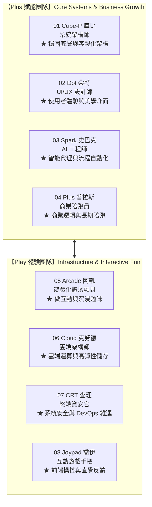

# PlayPlus 官方卡通吉祥物角色設定集（Mascot Character Bible）

> **品牌理念核心**：PlayPlus 普魯士國際成立於 2013 年，是「懂 UI/UX 和商業邏輯的客製化系統團隊」，秉持「**先理解、再設計、後開發**」的核心理念。  
> 吉祥物家族結合了 **Play（玩心、互動體驗、探索）** 與 **Plus（商業賦能、工程架構、持續陪跑）**，以友善、現代、具親和力的形象貫穿全站與數位產品生態。

---

## 一、視覺規範與設計語言（Design DNA）

全系列共 8 位吉祥物均遵循同一套現代 3D 黏土微立體（Claymorphism）視覺語彙，確保在官網各頁面出現時具備高度的一致性與辨識度：

1. **無邊框無粗黑線（Borderless & Clean）**：揚棄厚重視覺黑框，採用溫潤圓滑的 3D 體積光影與柔和環境遮蔽。
2. **統一五官與神態（Kawaii & Modern Tech）**：大眼高光反射、元氣粉嫩腮紅、開朗微笑；科技數位角（如 03 史巴克、07 查理）則採用青綠色發光螢幕神情。
3. **一致的四肢與配件（Apparel & Proportions）**：極簡俐落的黑色細管肢體、精巧小手掌，統一踩著 **PlayPlus 經典品牌綠（`#33CC33` / 湖水綠）** 白底休閒運動鞋。
4. **標準背景與陰影（Canvas & Lighting）**：暖調奶白背景（`#FAF9F5`），腳底帶有柔和的橢圓落地羽化漸層陰影。

---

## 二、吉祥物成員全景定位圖（Mascot Universe）

---

## 三、各角色詳細設定（Profile & Application）

---

### 01. 庫比（Cube-P）｜ 系統架構師

- **角色稱號**：Cube-P / 庫比
- **專業職務**：系統架構師（System Architect）
- **象徵領域**：客製化系統底層架構、高乘載工程、模組化軟體設計、資料結構規劃。
- **外觀特徵**：正面方正純淨的白色螢幕臉龐，頂部覆蓋品牌綠幾何保護外殼，手托一顆懸浮發光的綠色系統晶體方塊，眼神嚴謹而溫柔。
- **性格設定**：沉著冷靜、思維縝密、講求結構對齊。口頭禪是：「*好的架構，能讓系統穩定跑十年。*」
- **應用範疇**：
  - 系統後台架構說明、技術規格亮點圖示。
  - 大型企業客製化系統功能模組引導。
  - 複雜工作流（Workflow）解構。
- **wireframe 網站頁面類型舉例**：
  - [企業管理系統服務頁 (`services/enterprise-system.html`)](file:///Users/starchang/Documents/CloudFolder/GitHub/playplus2026/wireframe/services/enterprise-system.html)：擔任系統架構核心解說員，說明 ERP/CRM/進銷存模組。
  - [作品集案例詳情頁 (`portfolio.html`)](file:///Users/starchang/Documents/CloudFolder/GitHub/playplus2026/wireframe/portfolio.html)：例如在「神達會議室預約系統」案例中作為系統技術解析角色。
  - [知識筆記 (`blog.html`)](file:///Users/starchang/Documents/CloudFolder/GitHub/playplus2026/wireframe/blog.html)：架構選型、後端重構、微服務實戰文章的封面與導言人物。

---

### 02. 朵特（Dot）｜ UI/UX 設計師

- **角色稱號**：Dot / 朵特
- **專業職務**：UI/UX 設計師（Product & UX Designer）
- **象徵領域**：使用者介面設計、使用者體驗路徑（User Flow）、設計系統（Design System）、視覺品牌美學。
- **外觀特徵**：如水滴鵝卵石般光滑親近的膚質身型，頭戴湖水綠專業監聽耳機，右手執數位繪圖筆，左手懸浮著正在微調貝茲曲線與調色盤的半透明綠色介面面板。
- **性格設定**：敏銳細膩、極具同理心，對微小像素與互動間距有著無比的執著。口頭禪是：「*每個點擊，都該讓使用者感到流暢與愉悅。*」
- **應用範疇**：
  - 網頁設計美學展示、無障礙與易用性指引。
  - 官網色彩規範、字體排印、元件庫（Components）示範。
  - 線框圖（Wireframe）與原型（Prototype）展示說明。
- **wireframe 網站頁面類型舉例**：
  - [網頁設計服務頁 (`services/web-design.html`)](file:///Users/starchang/Documents/CloudFolder/GitHub/playplus2026/wireframe/services/web-design.html)：介紹 RWD 響應式、企業形象網站規劃的核心代言人。
  - [設計系統規範頁 (`design-system.html`)](file:///Users/starchang/Documents/CloudFolder/GitHub/playplus2026/wireframe/design-system.html)：全站配色、排版級距、按鈕態的規範示範角色。
  - [知識筆記 (`blog.html`)](file:///Users/starchang/Documents/CloudFolder/GitHub/playplus2026/wireframe/blog.html)：UI/UX 營運紅利、設計與商業結合相關文章封面（如《讓系統發揮最大價值：產品優化 UI/UX 能帶來的營運紅利》）。

---

### 03. 史巴克（Spark）｜ AI 工程師

- **角色稱號**：Spark / 史巴克
- **專業職務**：AI 工程師（AI & Automation Specialist）
- **象徵領域**：AI 智慧代理、Line / Web 聊天機器人、自然語言處理（NLP）、商業流程自動化串接。
- **外觀特徵**：高科技圓角菱形機器人軀體，頭頂有發送訊號的智慧天線，螢幕顯示友善的青綠色霓虹微笑雙眼，雙手身旁漂浮著對話氣泡與思考靈感星火。
- **性格設定**：學習力極強、反應快如閃電，熱愛探索新技術，專門幫繁複枯燥的流程找到秒級解答。口頭禪是：「*讓 AI 處理繁瑣日常，把時間留給重要思考。*」
- **應用範疇**：
  - 智能客服與聊天機器人功能模組。
  - 自動化 API 串接與資料分析。
  - 網站右下角即時對話助手（Live Assistant Widget）。
- **wireframe 網站頁面類型舉例**：
  - [聊天機器人服務頁 (`services/chatbot-development.html`)](file:///Users/starchang/Documents/CloudFolder/GitHub/playplus2026/wireframe/services/chatbot-development.html)：代表 Line 官方帳號、企業智能客服自動化方案的核心代言。
  - 全站懸浮客服按鈕 / 智能問答模組（Chat Widget Trigger）。
  - [知識筆記 (`blog.html`)](file:///Users/starchang/Documents/CloudFolder/GitHub/playplus2026/wireframe/blog.html)：AI 智能客服落地實踐、企業知識庫建置文章。

---

### 04. 普拉斯（Plus）｜ 商業陪跑員

- **角色稱號**：Plus / 普拉斯
- **專業職務**：商業陪跑員（Business Growth Companion）
- **象徵領域**：商業邏輯梳理、企業營運流程轉型、長期維運與陪跑夥伴、全案顧問諮詢。
- **外觀特徵**：飽滿圓潤的品牌純色綠十字「+」造型，活力奔跑躍進的動態，高舉象徵 PlayPlus 旗幟，面帶自信開朗的大笑臉。
- **性格設定**：正向積極、熱情可靠，是客戶團隊身後最堅實的後盾。口頭禪是：「*幫你多想一步，我們一起陪跑到終點！*」
- **應用範疇**：
  - 品牌核心價值、創立願景宣導。
  - 顧問預約表單引導、長期合作維護方案說明。
  - 各服務頁面尾端激勵轉化 CTA（Call to Action）橫幅。
- **wireframe 網站頁面類型舉例**：
  - [關於普魯士頁面 (`about-playplus.html`)](file:///Users/starchang/Documents/CloudFolder/GitHub/playplus2026/wireframe/about-playplus.html)：傳遞品牌初心「幫客戶多想一步，長期陪跑協助完成數位轉型」。
  - [立即諮詢頁面 (`contact.html`)](file:///Users/starchang/Documents/CloudFolder/GitHub/playplus2026/wireframe/contact.html)：諮詢表單頂部與提交成功提示的親切陪伴大使。
  - 全站所有文章與服務頁底部的「預約顧問諮詢」CTA 區塊。

---

### 05. 阿凱（Arcade）｜ 遊戲化體驗顧問

- **角色稱號**：Arcade / 阿凱
- **專業職務**：遊戲化體驗顧問（Gamification & Engagement Consultant）
- **象徵領域**：遊戲化機制（Gamification）、使用者互動黏著度、趣味微互動（Micro-Interactions）、行銷活動企劃。
- **外觀特徵**：經典迷你桌上型街機機台造型，石墨深灰消光機身環繞著一圈發光品牌綠霓虹飾邊，螢幕上有著可愛的萌萌水汪汪大眼，控制檯設有精巧搖桿與彩色按鈕。
- **性格設定**：熱愛冒險、富於幽默感，深信「再複雜的系統都可以變得好玩易懂」。口頭禪是：「*Insert Coin to Start！讓每次點擊都像通關一樣有成就感。*」
- **應用範疇**：
  - App 與系統中的積點、任務、會員等級與遊戲化機制解說。
  - 網站趣味彩蛋（Easter Eggs）與滑鼠懸停微動效引導。
  - 404 找不到頁面或維護頁面時的安撫與互動小遊戲。
- **wireframe 網站頁面類型舉例**：
  - [APP 開發服務頁 (`services/app-development.html`)](file:///Users/starchang/Documents/CloudFolder/GitHub/playplus2026/wireframe/services/app-development.html)：介紹使用者留存機制、打卡簽到與互動徽章系統。
  - 404 錯誤頁面（引導用戶返回首頁或進行趣味互動）。
  - [知識筆記 (`blog.html`)](file:///Users/starchang/Documents/CloudFolder/GitHub/playplus2026/wireframe/blog.html)：遊戲化體驗設計、如何提升用戶互動時長相關文章。

---

### 06. 克勞德（Cloud）｜ 雲端架構師

- **角色稱號**：Cloud / 克勞德
- **專業職務**：雲端架構師（Cloud Architect & Data Guardian）
- **象徵領域**：雲端運算環境（AWS/GCP/Azure）、高可用性彈性擴展（Auto-scaling）、資料庫與即時同步、雲端備份。
- **外觀特徵**：由蓬鬆柔軟純白泡泡組成的親切雲朵身軀，帶有微透青藍環境光感，手中托著象徵穩定資料的綠色矩陣立體光塊，招手傳遞信賴感。
- **性格設定**：溫和沉穩、包容力極大、穩若泰山。口頭禪是：「*不論流量浪潮有多大，雲端空間永遠為你平穩承載。*」
- **應用範疇**：
  - 企業雲端遷移、SaaS 雲端管理系統說明。
  - 資料庫安全備份、跨裝置即時資料同步與 API 串接介紹。
  - 伺服器運作狀態（99.9% Uptime）承諾保證。
- **wireframe 網站頁面類型舉例**：
  - [企業管理系統服務頁 (`services/enterprise-system.html`)](file:///Users/starchang/Documents/CloudFolder/GitHub/playplus2026/wireframe/services/enterprise-system.html)：說明雲端資料庫架構、分散式備份與災難復原保障。
  - [專業服務總覽頁 (`services.html`)](file:///Users/starchang/Documents/CloudFolder/GitHub/playplus2026/wireframe/services.html)：雲端化架構整合的核心介紹圖示。
  - [知識筆記 (`blog.html`)](file:///Users/starchang/Documents/CloudFolder/GitHub/playplus2026/wireframe/blog.html)：雲端遷移指南、資料庫優化、無伺服器架構（Serverless）實務篇章。

---

### 07. 查理（CRT）｜ 終端資安官

- **角色稱號**：CRT / 查理
- **專業職務**：終端資安官（Terminal Security & DevOps Officer）
- **象徵領域**：資訊安全防護、終端環境指令（CLI/Terminal）、DevOps CI/CD 自動化部署、伺服器效能監控。
- **外觀特徵**：經典方圓的復古深灰終端螢幕外殼，頂部有散熱格柵，螢幕中央散發自信的霓虹綠終端提示符微笑臉蛋，右手豪爽地比出「讚（Thumbs-Up）」。
- **性格設定**：原則鮮明、嚴謹守紀、安全感爆棚。口頭禪是：「*Code is Green, Security is Clear！有我在，系統滴水不漏。*」
- **應用範疇**：
  - 資訊安全標章（SSL 加密、權限管理、資安審計）。
  - 系統後台登入防護、雙因子驗證（2FA）提示引導。
  - 系統日誌監控（Monitoring）、自動化部署與維運狀態報告。
- **wireframe 網站頁面類型舉例**：
  - [隱私權政策 (`privacy.html`)](file:///Users/starchang/Documents/CloudFolder/GitHub/playplus2026/wireframe/privacy.html) 與 [服務條款 (`terms.html`)](file:///Users/starchang/Documents/CloudFolder/GitHub/playplus2026/wireframe/terms.html)：象徵對企業客戶資訊安全與機密資料的最高等級保護。
  - 後台系統登入與權限驗證頁面（作為安全守護盾牌插圖）。
  - [知識筆記 (`blog.html`)](file:///Users/starchang/Documents/CloudFolder/GitHub/playplus2026/wireframe/blog.html)：企業資安防禦策略、DevOps 自動化維運經驗分享。

---

### 08. 喬伊（Joypad）｜ 互動遊戲手把

- **角色稱號**：Joypad / 喬伊
- **專業職務**：互動遊戲手把（Frontend & Control Specialist）
- **象徵領域**：前端互動回饋、直覺操控體驗、行動端手勢（Touch & Gestures）、跨裝置無縫控制。
- **外觀特徵**：圓滑流線的現代白灰手把造型，兩側點綴品牌綠防滑握柄，左側為消光十字方向鍵，右側配有繽紛彩色的 ABXY 按鍵，中央帶著萌感歡呼笑顏，雙手向上高舉歡呼。
- **性格設定**：精力充沛、反應敏銳、掌控全場。口頭禪是：「*好系統就像好手把，拿起就能直覺上手！*」
- **應用範疇**：
  - 行動版響應式（RWD）操作手感與導覽切換展示。
  - 互動按鈕微動效、表單快捷操控、鍵盤快捷鍵指引。
  - 複雜數據圖表的即時互動篩選（Interactive Filters）。
- **wireframe 網站頁面類型舉例**：
  - [APP 開發服務頁 (`services/app-development.html`)](file:///Users/starchang/Documents/CloudFolder/GitHub/playplus2026/wireframe/services/app-development.html)：代表流暢好按的原生操控體驗與雙平台手勢流暢度。
  - [作品集總覽頁 (`portfolio.html`)](file:///Users/starchang/Documents/CloudFolder/GitHub/playplus2026/wireframe/portfolio.html)：專案分類按鈕切換（Filter Bar）與快捷操作的引導小幫手。
  - 行動版漢堡選單抽屜（Mobile Drawer Navigation）頂部的情境視覺。

---

## 四、PlayPlus Wireframe 網站整合應用對照矩陣

| 網站頁面路徑 | 頁面名稱 | 推薦主力吉祥物 | 次要搭配吉祥物 | 具體情境與功能 |
| :--- | :--- | :---: | :---: | :--- |
| `index.html` | 官網首頁 | **04 Plus** | 01 Cube-P, 02 Dot | 首頁 Hero 品牌理念引導、服務四大核心卡片輪播導覽。 |
| `about-playplus.html` | 關於我們 | **04 Plus** | 01 Cube-P, 06 Cloud | 傳遞「陪你完成數位轉型」願景，呈現 13+ 年專業顧問團隊底蘊。 |
| `services/enterprise-system.html` | 企業管理系統 | **01 Cube-P** | 06 Cloud, 07 CRT | 說明底層模組架構、高擴展性雲端資料庫與企業級資安防護。 |
| `services/web-design.html` | 網頁設計 | **02 Dot** | 08 Joypad | 闡述 UI/UX 使用者研究、直覺動線與極致美學視覺排版。 |
| `services/app-development.html` | APP 開發 | **08 Joypad** | 05 Arcade | 詮釋流暢的原生觸控反饋、跨平台整合與遊戲化留存黏著機制。 |
| `services/chatbot-development.html` | 聊天機器人 | **03 Spark** | 01 Cube-P | 介紹 Line 官方帳號 API 自動化、AI 智能回覆與工作流串接。 |
| `portfolio.html` | 精選作品集 | **08 Joypad** | 02 Dot, 01 Cube-P | 專案分類即時切換 Filter、案例成果解構與操作亮點導讀。 |
| `blog.html` | 知識筆記 | **02 Dot** | 03 Spark, 05 Arcade | 部落格文章分類標籤、知識專題卡片封面與引言註解。 |
| `contact.html` | 預約顧問諮詢 | **04 Plus** | 07 CRT | 表單引導、諮詢資料送出安全保證與顧問團隊回覆狀態。 |
| `design-system.html` | 設計系統 | **02 Dot** | 01 Cube-P | 色票色彩展示、排版階層、按鈕組件庫規範標準示範。 |
| `privacy.html` / `terms.html` | 隱私權政策與條款 | **07 CRT** | 06 Cloud | 資訊安全隱私防護、資料備份安全規範宣示。 |
| 404 / 系統維護頁面 | 錯誤情境頁 | **05 Arcade** | 07 CRT | 幽默化解找不到頁面的突兀感，提供回到首頁按鈕或小彩蛋。 |

---

## 五、檔案資產清單

本系列 WebP 檔案皆儲存於 `AI-Agent/PlayPlus_Official_Website/📔資源/卡通吉祥物/` 目錄：

1. [01_Cube-P_庫比_系統架構師.webp](file:///Users/starchang/Documents/CloudFolder/GitHub/AI-Agent/PlayPlus_Official_Website/📔資源/卡通吉祥物/01_Cube-P_庫比_系統架構師.webp) (47.7 KB)
2. [02_Dot_朵特_UIUX設計師.webp](file:///Users/starchang/Documents/CloudFolder/GitHub/AI-Agent/PlayPlus_Official_Website/📔資源/卡通吉祥物/02_Dot_朵特_UIUX設計師.webp) (59.0 KB)
3. [03_Spark_史巴克_AI工程師.webp](file:///Users/starchang/Documents/CloudFolder/GitHub/AI-Agent/PlayPlus_Official_Website/📔資源/卡通吉祥物/03_Spark_史巴克_AI工程師.webp) (60.8 KB)
4. [04_Plus_普拉斯_商業陪跑員.webp](file:///Users/starchang/Documents/CloudFolder/GitHub/AI-Agent/PlayPlus_Official_Website/📔資源/卡通吉祥物/04_Plus_普拉斯_商業陪跑員.webp) (43.8 KB)
5. [05_Arcade_阿凱_遊戲化體驗顧問.webp](file:///Users/starchang/Documents/CloudFolder/GitHub/AI-Agent/PlayPlus_Official_Website/📔資源/卡通吉祥物/05_Arcade_阿凱_遊戲化體驗顧問.webp) (59.5 KB)
6. [06_Cloud_克勞德_雲端架構師.webp](file:///Users/starchang/Documents/CloudFolder/GitHub/AI-Agent/PlayPlus_Official_Website/📔資源/卡通吉祥物/06_Cloud_克勞德_雲端架構師.webp) (47.8 KB)
7. [07_CRT_查理_終端資安官.webp](file:///Users/starchang/Documents/CloudFolder/GitHub/AI-Agent/PlayPlus_Official_Website/📔資源/卡通吉祥物/07_CRT_查理_終端資安官.webp) (58.2 KB)
8. [08_Joypad_喬伊_互動遊戲手把.webp](file:///Users/starchang/Documents/CloudFolder/GitHub/AI-Agent/PlayPlus_Official_Website/📔資源/卡通吉祥物/08_Joypad_喬伊_互動遊戲手把.webp) (56.9 KB)
