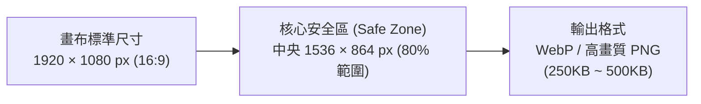
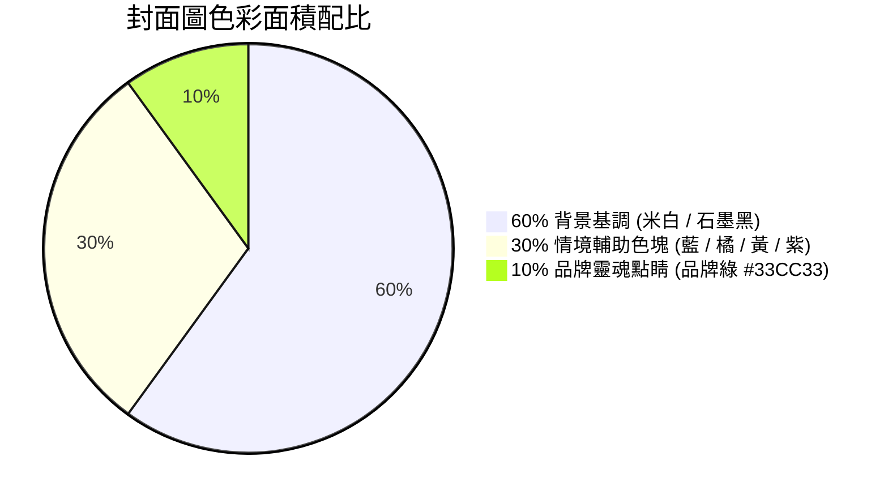

# PlayPlus 部落格封面情境圖設計與使用手冊 (Blog Cover Visual Bible)

> **制定核心**：為 PlayPlus「懂 UI/UX 與商業邏輯的客製化系統團隊」打造一致、高質感且具國際視野的部落格封面視覺體系。  
> **風格取向**：融合現代科技風格（如 Stripe、Notion、LottieFiles、Canva），以「**純色塊扁平卡通（Pure Vector）**」與「**向量色塊 + 擬真照片/UI 拼貼（Mixed-Media Collage）**」為雙軌核心。

---

## 一、基礎規格與畫布定義

1. **標準尺寸**：`1920px × 1080px`（標準 **16:9** 高解析度比例）。
2. **安全構圖範圍（Safe Zone）**：
   * 所有核心主體（主要角色、道具、數據標籤、擬真裝置）均須座落在**中央 80% 區域（約 1536 × 864 px）**內。
   * 四周邊緣保留 10%~15% 的背景呼吸空間，確保在官網各裝置縮圖、卡片外框或社群分享（OG Image）時，主體不會被裁切。
3. **檔案格式與規範**：
   * 官網上線統一使用 `.webp` 格式，維持色彩鮮明且檔案控制在 250KB~500KB 之間。
   * 保留向量母檔（Figma / Illustrator）或分層原始檔案，以便日後微調或延伸應用。

---

## 二、雙軌視覺模式（Two Visual Modes）

封面圖不拘泥於單一表現手法，根據文章主題深度與屬性靈活選用以下兩大模式：

| 維度 | 【模式 A】純色塊幾何卡通場景 (Pure Vector) | 【模式 B】混和媒材拼貼 (Mixed-Media Collage) |
| :--- | :--- | :--- |
| **視覺特徵** | 100% 幾何純色塊、俐落剪影、無多餘漸層（可帶極細微顆粒噪點 Grain/Noise）、平面幾何物件。 | 擬真高質感照片（如手持手機、真實程式碼視窗、實體店面、咖啡杯、硬體設備）+ 穿插手繪色塊向量、對話框與貼紙。 |
| **視覺氛圍** | 親切、幽默、具親和力，能將抽象理論降維演繹。 | 專業、落地、具實戰信賴感，突顯真實商業場景與產品細節。 |
| **最佳適用** | 抽象觀念、思維心法、底層架構、技術科普、預算邏輯。 | 產業落地案例、真實軟體工具實操（Notion/Figma）、跨國時事、商業數據。 |

---

## 三、吉祥物角色使用規範（靈活彈性原則）

吉祥物是 PlayPlus 品牌活力的重要載體，但在封面圖設計中**採取彈性機制，不強制每張圖都必須出現**：

### 3.1 三種出場型態
1. **型態 1：無吉祥物出場（Pure Object / Concept Scene）**
   * **適用情境**：純概念展示、介面解析、客觀數據或專注於擬真 UI 呈現時。
   * **表現手法**：以幾何道具、代碼編輯器、數據圖表、天平、收據機等「隱喻物件」作為純視覺主角，風格乾淨俐落。
2. **型態 2：單隻吉祥物出場（Single Spotlight）**
   * **適用情境**：文章主題緊扣該吉祥物的專屬專業領域時。
   * **角色對應**：
     * `01 庫比 (Cube-P)`：系統架構、規格定義、模組化工程。
     * `02 朵特 (Dot)`：UI/UX 體驗、美學設計、轉換率優化。
     * `03 史巴克 (Spark)`：AI 智能、自動化流程、LINE Chatbot。
     * `04 普拉斯 (Plus)`：商業思維、顧問訪談、轉型陪跑、預算效益。
     * `05 阿凱 (Arcade)`：遊戲化留存、微互動、趣味 404 錯誤。
     * `06 克勞德 (Cloud)`：雲端基礎設施、高擴展性、資料庫備份。
     * `07 查理 (CRT)`：資訊安全防護、DevOps、HTTP 狀態除錯。
     * `08 喬伊 (Joypad)`：前端操控體驗、行動端手勢、直覺互動。
3. **型態 3：多隻吉祥物協同出場（Multi-Mascot Collaboration）**
   * **適用情境**：文章涉及**「跨領域協作」**、**「全案整合流程」**或**「團隊陪跑心法」**時（例如：設計與工程協作、從策略到落地的專案啟動）。
   * **構圖互動**：多隻角色之間必須具備**互動關係**（例如：互相遞交組件方塊、合力組裝積木、並肩登山、一人操控一人指示），而非呆板並排站立。

### 3.2 吉祥物造型繪製基準
* **五官神態**：大黑豆豆眼 + 雙點白高光 + 弧形開朗微笑 + 元氣粉嫩腮紅（科技螢幕角色如史巴克、查理則為發光霓虹線條面孔）。
* **極簡肢體**：黑色細單線肢體（Noodle Limbs），無多餘指節與關節，動作誇張流暢。
* **統一穿戴**：角色若有穿鞋，統一踩著 **PlayPlus 品牌綠 (`#33CC33`) 白底運動鞋**。
* **落地陰影**：角色腳底或懸浮物件下方，均配置帶有羽化透明度的扁平橢圓投影。

---

## 四、色彩系統與視覺層次（60-30-10 法則）

1. **60% 背景基調色**：
   * **溫暖米白（主力推薦）**：`#FAF9F5` / `#F0EEE6`，高質感且與全站米白風格無縫銜接。
   * **深色/夜間（科技/資安/代碼主題）**：`#15161A`（石墨黑）搭配微透的寶藍背景塊。
2. **30% 構圖情境色塊**：
   * 選用飽和度充足、明亮清爽的現代扁平色：活力珊瑚橘 (`#FF5C35`)、天空湛藍 (`#00A3FF`)、暖陽金黃 (`#FFC700`)、優雅紫羅蘭 (`#9E77ED`)。
3. **10% 品牌靈魂點睛色**：
   * **PlayPlus 經典品牌綠 (`#33CC33`)**：必定出現於視覺視覺焦點（例如核心開關、主要標籤、成功打勾、發光按鈕、吉祥物運動鞋）。

---

## 五、文字與裝飾標籤原則

* ❌ **嚴禁壓上長篇中文標題**：文章頁面與卡片下方本就包含大標題，圖面重複寫上完整標題會破壞國際感並顯得雜亂。
* ✅ **僅允許概念關鍵字與徽章貼紙（Badge Stickers）**：
  * **字數限制**：1~3 個英文字彙或簡短數據。
  * **推薦標籤示範**：`404`、`Notion`、`Figma`、`+30%`、`WHAT / WHO / HOW`、`$ VS ROI`、`24/7 ONLINE`、`YEAR 1-3`、`AI WORKFLOW`。
  * **外型風格**：以色塊膠囊藥丸（Pill Badge）、斜角徽章、或是帶邊框的便利貼形式呈現。

---

## 六、26 篇部落格封面分鏡規劃矩陣

本矩陣為 PlayPlus 現有 26 篇部落格文章提供具體的視覺腳本指南，展示「無吉祥物」、「單隻」與「多隻協作」的靈活運用：

| # | 文章主題（檔案名稱） | 推薦模式 | 吉祥物配置 | 核心畫面分鏡與構圖設計（視覺隱喻） |
| :-: | :--- | :---: | :---: | :--- |
| **01** | **網頁設計預算評估長期效益** `20250604-web-design-budget.html` | 模式 A | **單隻** (04 普拉斯) | 暖米白背景。中央一座幾何金色天平：一端是輕薄的小銅板（標籤 $），另一端是普拉斯緊抱著持續向上生長的綠色階梯，天平穩健倒向長期價值。 |
| **02** | **中小企業數位轉型：策略優先** `20250612-sme-digital-transformation-strategy-first.html` | 模式 A | **單隻** (04 普拉斯) | 俯視角度的戰略藍圖。混亂散落的虛線箭頭中，普拉斯手持羅盤，畫出一條筆直通向山頂旗幟的綠色路徑。 |
| **03** | **網站只是工具，行銷策略才是核心** `20250623-marketing-strategy-not-just-website.html` | 模式 A | **無吉祥物** | 巨大且極簡的色塊行銷漏斗：頂部注入繽紛的幾何人潮，透過中央多層精密齒輪轉化，底部精準產出一顆顆發光的星星與成長金幣。 |
| **04** | **網頁設計報價前為何一定要先訪談？** `20250702-web-design-quote-why-interview-first.html` | 模式 A | **雙隻協同** (04 普拉斯 + 01 庫比) | 圓桌會議場景。普拉斯拿著超大放大鏡專注聆聽，庫比在旁邊的看板上將對話內容即時轉化為整齊對齊的結構積木。 |
| **05** | **數位轉型第一步：釐清工作流程** `20250717-digital-transformation-first-step-workflow.html` | 模式 A | **單隻** (01 庫比) | 庫比手持指揮棒，將左側一團打結纏繞的混亂紅色線團，一步步梳理成右側整齊流暢、帶有綠色打勾標籤的標準作業輸送帶。 |
| **06** | **什麼是 UI/UX？基本觀念全解析** `20250729-what-is-ui-ux-user-experience-basics.html` | 模式 A | **單隻** (02 朵特) | 朵特左手拿著代表「UI」的精緻彩度調色盤，右手拿著代表「UX」的微笑量角器，正在精心調整一條絲滑順暢的立體弧線軌道。 |
| **07** | **餐廳網頁設計 5 個轉換率關鍵** `20250902-restaurant-website-5-essentials-conversion-tw.html` | **模式 B** | **單隻** (08 喬伊) | **擬真**：真實手持 iPhone 照片。**插畫**：螢幕內為色塊美食餐盤，喬伊興奮地按下一顆發光的綠色「線上訂位」大按鈕，周圍飄著美味香氣向量線條。 |
| **08** | **專案啟動必備 3 問題：What, Who, How** `20250913-project-kickoff-3-questions-what-who-how.html` | 模式 A | **三隻協同** (01 庫比 + 02 朵特 + 04 普拉斯) | 畫面上立起三座彩色幾何高塔，分別印著「WHAT」、「WHO」、「HOW」，三位隊員合力將最後一顆綠色核心方塊安裝定位。 |
| **09** | **常見 HTTP 狀態碼全解析（404/500）** `20250923-http-status-code.html` | 模式 A | **無吉祥物** (純概念機台) | 參考圖 7.07.35。復古薄荷綠色印表機吐出一條長長的列印紙，中央蓋著顯眼的紅色放大鏡圖章，印著大字「404 PAGE NOT FOUND」。 |
| **10** | **UI/UX 不只是好看：直接影響營收** `20250923-ui-ux-business-value.html` | 模式 A | **單隻** (02 朵特) | 朵特拉下一個綠色開關搖桿，原本低迷沉悶的折線圖瞬間如火箭般呈 45 度向上飆升，頂端伴隨著灑落的金幣與笑臉光芒。 |
| **11** | **愛爾蘭數位轉型考察隨筆** `20260311-digital-transformation-lessons-from-ireland.html` | **模式 B** | **單隻** (04 普拉斯) | **擬真**：都柏林經典彩色大門或街景去背相片。**插畫**：普拉斯頭戴三葉草飾品、手提行囊健步邁進，空中劃出一條跨國虛線飛行軌跡。 |
| **12** | **櫻花季談數位轉型：短暫盛開或四季常青** `20260311-digital-transformation-sakura.html` | 模式 A | **無吉祥物** | 詩意的對比構圖：左側為隨風飄散的幾何粉色櫻花枝（象徵短暫跟風熱潮）；右側為根系深扎土壤、結滿綠色系統晶體果實的常青幾何大樹。 |
| **13** | **我們堅持用 Notion 與 Figma 協作** `20260311-we-use-notion-and-figma.html` | **模式 B** | **雙隻協同** (02 朵特 + 01 庫比) | **擬真**：Figma 畫布與 Notion 看板的真實雙重視窗。**插畫**：朵特從 Figma 視窗探出半身，把設計好的幾何模組遞給 Notion 視窗裡的庫比，展現無縫協同。 |
| **14** | **為什麼產品需要 UI/UX 優化？** `20260311-why-you-need-ui-ux-optimization.html` | 模式 A | **單隻** (02 朵特) | 左側為滿布灰色荊棘與死胡同的複雜老舊介面；右側朵特推平障礙，展開一條明亮清爽的直達綠色走道，標註著「SMOOTH FLOW」。 |
| **15** | **案例：獨立咖啡廳網站提升 30% 訂位量** `20260317-case-study-cafe-website-ui-ux.html` | **模式 B** | **無吉祥物** | **擬真**：精美拉花咖啡杯與實木吧檯照片。**插畫**：咖啡杯後方襯著大大的幾何綠色圓形標籤，印著「+30% BOOKING」與手繪預約確認勾選框。 |
| **16** | **LINE 官方帳號加 Chatbot 客服** `20260323-line-chatbot-business.html` | 模式 A | **單隻** (03 史巴克) | 沉靜夜景。中央是一台亮著光芒的 LINE 綠色對話機台，史巴克頭戴小耳機，身邊圍繞著「24/7 ONLINE」徽章與不斷自動回覆的閃亮對話泡泡。 |
| **17** | **數位轉型實戰心法：長期陪跑** `20260324-digital-transformation-journey.html` | 模式 A | **多隻協同** (全體吉祥物剪影) | 晨曦初升的綿延幾何山巒。普拉斯、庫比、朵特等隊員背起行囊，手牽手排成隊伍沿著向上的步道前進，象徵團隊並肩長期陪伴。 |
| **18** | **用 Notion 打造專案管理中樞** `20260408-notion-project-management.html` | **模式 B** | **單隻** (01 庫比) | **擬真**：真實的 Notion 專案儀表板截圖。**插畫**：庫比手持發光指揮棒，宛如機場塔台工程師，指揮著彩色專案任務紙飛機有序降落進各欄位中。 |
| **19** | **Zoomex 交易平台改版體驗解析** `20260410-zoomex-update-ui-ux-design.html` | 模式 A | **單隻** (08 喬伊) | 參考圖 7.05.29（Robinhood 風格）。深黑背景，懸浮著精準的 3D 綠色等角 K 線柱狀圖與流動的數據代幣，喬伊在旁俐落地推動操作手柄。 |
| **20** | **2026 網頁設計費用行情指南** `20260414-web-design-budget-guide.html` | 模式 A | **雙隻協同** (04 普拉斯 + 01 庫比) | 畫面上並排三座房子：從左邊簡陋的紙箱模版屋，到中間的標準磚房，再到右邊庫比與普拉斯親手打造、結構紮實穩固的客製化智能科技大樓。 |
| **21** | **B2B 科技業數位轉型與官網出海** `20260417-b2b-tech-digital-trend.html` | **模式 B** | **單隻** (06 克勞德) | **擬真**：真實太空視角藍色地球儀。**插畫**：克勞德坐在地球上方，向世界各大洲的科技節點發射亮綠色的光纖訊號網絡。 |
| **22** | **網站功能規劃與擴充性（為未來3年準備）** `20260422-website-feature-planning-and-expansion.html` | 模式 A | **單隻** (01 庫比) | 庫比手持施工藍圖，正在搭建穩固的樂高模組高樓。地基沉穩寬廣，上方預留有整齊的半透明插槽，插槽上浮現「Year 1」、「Year 2」、「Year 3」。 |
| **23** | **川普行政命令影響跨境金流準備** `20260707-trump-order-web-design.html` | **模式 B** | **無吉祥物** | **擬真**：美國官方建築或經貿法律文件剪影。**插畫**：堅固的金屬幾何盾牌橫亙中央，盾牌上散發綠色 SSL 防護光芒，抵擋住外圍波動混亂的匯率線條。 |
| **24** | **Google Stitch 與 Vibe Coding 協作革命** `20260708-google-stitch-vibe-coding-ui-draft.html` | 模式 A | **雙隻協同** (03 史巴克 + 02 朵特) | 朵特隨手揮灑出一道彩色光帶，史巴克的天線一感應，光帶在半空中瞬間「晶體化」變為工整漂亮的代碼與可點擊的介面元件，科技感十足。 |
| **25** | **會員系統商業價值：單次到終身價值** `20260714-membership-commercial-value.html` | 模式 A | **單隻** (05 阿凱) | 參考圖 7.08.20。阿凱開啟一個滿溢光芒的幾何黃金寶箱，噴發出璀璨的鑽石、VIP 徽章與標註「LTV MAX」的火箭星芒。 |
| **26** | **系統優化提升內部管理效率 50%** `20260724-ui-ux-system-optimization-value.html` | 模式 A | **無吉祥物** | 一個巨大、極簡的儀表板速度指針，指針瞬間衝破紅色的壅塞怠速區，直達右上方發光的綠色區塊，伴隨「+50% SPEED」的動感速度標籤。 |

---

## 七、設計檢驗與品質把關清單 (Quality Checklist)

在任何封面情境圖完稿輸出前，請依序核對以下重點：

> [!IMPORTANT]
> **5 秒識別原則（The 5-Second Test）**：
> 讀者在瀏覽文章列表時，能否在 **5 秒內** 透過核心隱喻心領神會？（例如：看到天平感知預算價值、看到印表機感知 404、看到 Notion+Figma 感知雙工具協作）。

- [ ] **尺寸與比例**：畫布是否為 `1920 × 1080 px`（16:9）？
- [ ] **安全取景（Safe Zone）**：所有主角、重要道具或標籤文字是否均位在中央 80% 區域內？四周是否留有充足呼吸感？
- [ ] **吉祥物出場邏輯**：
  - 若**無吉祥物**：概念隱喻物件（如漏斗、天平、印表機、UI）是否足夠鮮明生動？
  - 若**多隻吉祥物**：彼此之間是否有邏輯互動（傳遞、組裝、討論），而非生硬並排？
- [ ] **色彩層次**：是否遵循「60% 乾淨底色 + 30% 輔助幾何色 + 10% 品牌綠」的色彩配比？
- [ ] **混和媒材去背精緻度（模式 B）**：擬真照片是否有毛邊？是否透過圓角視窗、相框或手繪線條實現有機融合？
- [ ] **文字極簡**：是否嚴格避免放整句文章長標題？是否僅保留精煉的 Badge 標籤或關鍵字？
