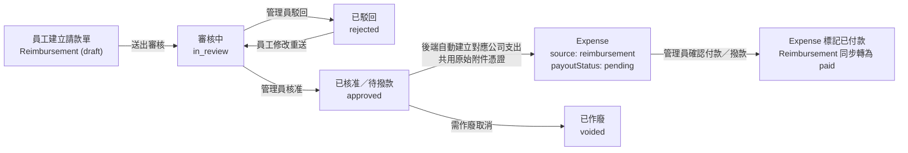

# QUICKEY（快記）產品介紹

**團隊用快記，帳務更省力。**

**QUICKEY（快記）** 是一款專為**中小企業、工作室、新創團隊與一人公司**打造的**雲端團隊內帳與費用管理平台**，整合「現金收支記帳、團隊代墊款請款簽核、預算管理與營運報表」，讓企業不需要繁瑣的傳統會計軟體，也不必再靠分散各處的 Excel 與聊天群組手動拼湊帳目。

透過 **AI 智慧辨識發票與收據**，團隊成員用手機拍照就能送出請款或記帳，管理者可於線上單層快速簽核並排程撥款；系統同時協助區分「實際發生損益」與「現金實際進出帳戶」的時間差，讓負責人與財會人員隨時掌握公司帳戶餘額、預算執行率與損益現金流，大幅減少重複登打與月底對帳的負擔，把時間留給更重要的事。

> **目前開放狀態**：QUICKEY 現正進行**封閉測試（Closed Beta）**，封測期間註冊之企業皆可直接體驗完整團隊版功能；如欲申請封測或洽詢合作，歡迎透過官方網站與我們聯繫。

---

## 一、產品總覽與市場定位

### 1.1 產品定位
**QUICKEY（快記）**（專案早期曾命名為 ExpensePal，於 2026 年 9 月正式更名）是一款專為**台灣中小型企業、工作室與新創團隊**打造的**雲端團隊內帳與費用管理平台**。

相較於傳統套裝會計軟體過於繁重、或單純用 Excel 與 LINE 群組協作容易掉單與算錯帳，QUICKEY 聚焦在團隊每天真實發生的三件財務日常：
1. **公司現金與銀行收支記帳**：快速紀錄每筆收入、支出、應收／應付與多帳戶資金流向。
2. **員工代墊款請款與簽核撥款**：員工手機拍發票即可送出請款，主管／會計一鍵審核並排程撥款。
3. **預算控管與雙口徑經營報表**：依支出類別設定月度或年度預算即時追蹤超支風險，並自動產出「損益」與「現金流」兩種口徑的報表。

### 1.2 核心解決的痛點
- **憑證收集散落、人工登打耗時**：憑證或電子發票需要跨手機與電腦整理、逐筆核對金額、統編與發票日期。
- **請款混進公司帳、還沒核准就先算支出**：員工送件但尚未核准的代墊請款，若直接混入公司支出總額，會使當期費用與預算使用率失真。
- **「發生日」與「實付日」混用導致報表與帳戶衝突**：營業／費用歸屬期間與實際現金進出帳戶的日期經常不同，若只有單一日期欄位，難以同時對準損益與現金流。
- **資金互轉被誤算成收入或支出**：帳戶間調度資金若誤記為一般收支，會扭曲營運損益與預算執行數據。

### 1.3 產品設計原則與系統邊界（做什麼 / 不做什麼）

QUICKEY 的核心原則是**「把團隊日常內帳顧到乾淨、準確、好查核」**，並明確劃定與外部會計／稅務申報（外帳）的邊界：

| 領域 | QUICKEY 聚焦範圍（現階段核心） | 明確不納入／後續才評估的領域 |
| :--- | :--- | :--- |
| **帳務性質** | 團隊日常**內帳管理**（現金收支、代墊款、預算、帳戶餘額、營運損益與現金流） | 完整複式借貸分錄傳票系統、正式稅務申報／會計師簽證財報（外帳） |
| **組織與簽核** | 輕量**單層簽核**（員工送審 → 管理員核准／駁回 → 撥款結案） | 複雜多部門矩陣架構、多層級串聯／並聯簽核規則 |
| **幣別與帳務延伸** | 以**新台幣（TWD）**計價，支援跨帳戶調度與手續費連動，且不阻擋帳戶負餘額以符合實務彈性 | 多幣別匯兌損益評價、庫存進銷存與薪資算薪系統 |
| **外帳銜接** | 內建商業會計科目代碼與乾淨的分類結構，支援依條件匯出 CSV 與憑證 ZIP 壓縮檔交給會計師 | 直接連線國稅局申報營業稅或營所稅 |

### 1.4 目標客群與角色模型規劃
依產品規格文件（PRD），QUICKEY 針對中小企業／工作室／新創團隊中的 **4 個核心角色情境（Personas）** 進行需求設計，並在實際系統權限上收斂為簡潔的**雙角色模型**：
- **管理員（`admin`）**：對應企業負責人、創辦人、行政或內帳會計等財務管理職責，統一於管理員後台掌握公司整體現金流、損益、預算、簽核撥款與人員／系統治理。
- **一般員工（`employee`）**：對應需提出個人代墊款項之團隊成員，透過簡潔的手機優先前台快速拍照請款與追蹤撥款進度。

---

## 二、角色權限與雙入口架構

為了讓不同身分的成員擁有最適合的操作介面，QUICKEY 採用 **兩個角色（`admin` / `employee`）** 與 **兩套專屬操作入口** 的架構：

### 2.1 雙入口與權限劃分

| 角色代碼 | 顯示身分 | 操作入口 | 介面設計重點 | 權限範圍 |
| :--- | :--- | :--- | :--- | :--- |
| **`admin`** | 管理員／老闆／會計 | **管理員後台**（`/admin`） | 桌機管理與批次處理優先，具備完整側邊欄與全站搜尋 | 擁有全公司帳務完整權限：一般收支、固定收支、資金移轉、請款審核與撥款、損益／現金流報表、預算與類別、帳戶與公司設定、人員邀請與管理、垃圾桶管理、資料匯出、稽核日誌。 |
| **`employee`** | 一般員工 | **員工前台**（`/app`） | 手機優先（Mobile-first）與 PWA 安裝體驗，操作步驟極簡化 | **僅限本人代墊款請款**：查看個人請款狀態首頁、拍照／手動新增請款單、查閱個人歷史請款與狀態進度、接收個人簽核與撥款通知。可刪除本人「草稿」或「已駁回」單據；無法瀏覽公司總帳、帳戶餘額、報表與他人資料。 |

### 2.2 公司開通與成員加入流程
1. **公司註冊**：管理員透過註冊頁建立公司（支援「公司 `limited`」與「工作室 `studio`」等型態選項，資料模型層另備有 `corporation` 股份有限公司與 `individual` 個人型態），完成 Email 註冊驗證（`SignupToken`）後立即開通後台。
2. **邀請員工**：管理員於後台「人員管理」發送專屬邀請連結（`Invitation`）給團隊成員，成員依連結設定密碼後即可從員工前台登入使用；管理員亦可於後台管理或停用成員帳號。

---

## 三、核心會計設計邏輯（產品差異化關鍵）

QUICKEY 在資料結構上刻意解決一般簡易記帳 App 與試算表最容易混淆的兩件事：**日期口徑**與**請款／支出生命週期**。

### 3.1 「四種日期」清晰分流：同時算準損益與現金流
每筆支出與收入最多支援四個明確語意的日期欄位，讓同一筆交易在「營運成績」與「銀行對帳」上各自歸位：

1. **發生日期（`date`）**：費用或營收實際發生的日期 → 作為 **損益報表（P&L）** 與 **預算執行統計** 的歸屬月份／日期依據。
2. **實收／實付日期（`collected_at` / `paid_at`）**：現金真正進出銀行或零用金帳戶的日期 → 作為 **現金流報表** 與 **帳戶餘額變動** 的依據。
3. **發票日期（`invoice_date`）**：發票或憑證開立日期。當使用者填寫或透過 OCR 辨識帶出發票日期時，系統在適用情況下可自動填入發生日期（但修改發生日期不會反向覆蓋發票日期）。
4. **應收／應付日期（`planned_collection_date` / `planned_payout_date`）**：預計收款或付款期限 → 用於待收／待付清單排序分組與 **逾期提醒計算**（依 `Asia/Taipei` 台北時間計算，逾期滿 1 天以上才標記逾期並發送通知，不含到期當日）。

### 3.2 「代墊請款」與「公司支出」雙模型分離與自動連動
員工提出代墊請款時，並不直接寫入公司支出表，而是透過兩個獨立模型保持帳務純淨：

- **未核准前不污染帳務**：處於 `draft`（草稿）、`in_review`（審核中）、`rejected`（已駁回）狀態的請款單，**完全不計入**公司支出總額、損益報表與預算消耗。
- **核准即自動轉成應付支出**：管理員在「簽核」頁面核准後，系統將請款單轉為 `approved`，並自動建立一筆 `source = 'reimbursement'`、付款狀態為 `pending`（待撥款）的公司 `Expense`，完整複製費用明細並**共用實體憑證附件檔案**（不重複佔用雲端儲存空間）。
- **撥款即同步結案**：會計或管理員於支出／待撥款畫面完成撥款並標記實付日期後，系統自動將對應請款單狀態更新為 `paid`（已撥款），並發送通知給請款員工。
- **完整生命週期稽核**：請款單另有 `voided`（已作廢）狀態，取代直接硬刪除已進流程的單據；每一步核准、駁回與狀態變化皆記錄於 `ApprovalEvent` 與系統 `AuditLog`。

---

## 四、功能模組詳解

### 4.1 儀表板與全站搜尋（Dashboard & Global Search）
- **管理員儀表板**：彙總當期總收入、總支出與淨損益、待收款／待付款／逾期帳款摘要、待簽核請款筆數、各帳戶即時餘額概覽，以及當期類別預算消耗狀況，讓管理者登入後立刻掌握全局。
- **全站搜尋（`GlobalSearch`）**：提供跨模組快速檢索帳務記錄，迅速定位特定單據或備註內容。

### 4.2 支出管理（Expenses）與四種記帳輸入方式
管理員可完整記錄公司直接發生的各項花費（含多筆明細 `ExpenseItem`、付款狀態已付／待付、對應帳戶、四種日期與最多 5 個憑證附件），並支援四種彈性輸入方式：

1. **單筆 AI OCR 拍照／PDF 智慧辨識**（`POST /api/ocr/recognize`）
   - 支援一次上傳最多 **5 個檔案**（單檔 ≤ 5 MB，PDF 最多 15 頁）。
   - 結合 **Google Vertex AI `gemini-3.1-flash-lite`** 與 **台灣電子發票左右 QR Code 解碼（`libzbar`）優先覆寫機制**：透過掃碼解讀台灣電子發票雙 QR Code 並優先覆寫辨識欄位，提升發票與明細判讀準確率。
   - 內建自動欄位校驗（例如台灣統一編號檢核碼驗證、發票字軌前綴 + 8 碼數字格式檢查）。
   - 多檔案辨識支援資料合併，若各圖檔資訊衝突或偵測到多張發票，會主動彈出衝突確認／多張發票選擇視窗供人工確認。
2. **批次匯入憑證／多張收據同頁裁切辨識**（`POST /api/ocr/batch`）
   - 適合月底一次掃描或拍攝多張收據整理入帳：支援單次最多 **5 個檔案**、單檔最高 **20 MB**、總頁數最多 **5 頁**、每頁最多可同時辨識 **10 張收據**，辨識後一次預覽並批次確認建立多筆草稿／支出記錄。
3. **Excel 試算表匯入（`.xlsx`）**
   - 提供標準匯入範本，上傳後先進入預覽（`preview`）步驟，可在畫面中進行系統類別／帳戶對應與逐列剔除不需匯入之資料，確認無誤後以交易原子性方式一次匯入（`import`）。
4. **手動輸入**：支援單筆或多明細項目快速建立，亦可透過負數金額記錄處理部分退款情境。

### 4.3 收入管理（Incomes）
- 與支出管理維持一致的雙口徑日期架構，支援多明細項目（`IncomeItem`）、收款狀態（已收款／待收款）、入帳帳戶選擇、憑證附件上傳（每筆最多 5 個檔案、單檔 ≤ 5 MB），並支援對應角色欄位的 AI OCR 收據／發票辨識。

### 4.4 代墊款請款、簽核與撥款排程（Records, Review & Payout Schedule）
- **員工前台請款**：手機拍照即可套用 AI OCR 自動帶出發票日期、金額、統編與明細，選擇費用類別與填入說明後，可先存為草稿（`draft`）或直接送審（`in_review`）。
- **管理員「請款記錄」與「簽核」**：獨立的待審核工作台，清楚列出申請人、金額、類別、明細與發票附件預覽，支援「核准」或「駁回」作業；已作廢（`voided`）單據必要時亦可執行取消作廢（`revert_void`）。
- **公司固定付款日排程（`PayoutSchedule`）**：支援公司設定統一撥款／發薪週期排程，並以獨立資料表（`payout_day_change_logs`）保留付款日變更軌跡。

### 4.5 固定收支（Recurring Templates）
- 針對房租、雲端／SaaS 訂閱費、電信網路費、每月固定顧問收入等週期性帳務，可建立固定收支範本。
- 支援設定**每月或每年**重複週期與指定執行日（`dayOfMonth` 1～31 日；若遇 2 月或小月無該日期，系統自動對齊該月最後一天）。
- **自動產單與歷史補齊機制**：
  - 排程任務於每日**台北時間 00:30** 自動依範本產生到期之待收／待付記錄。
  - 若建立範本時設定的起始月份（`startMonth`）早於當月，系統會**立即自動補齊過去月份應產生的待處理記錄**，確保歷史期別帳務完整。

### 4.6 帳戶設定與資金移轉（Accounts & Transfers）
- **多帳戶資金追蹤**：可建立公司各銀行帳戶、零用金現金櫃或數位帳戶，並為每個帳戶設定**起始金額（`opening_amount`）與起始月份（`opening_month`）**。
- **即時帳戶餘額公式**：
  $$\text{帳戶餘額} = \text{起始金額} + \text{已收款收入} - \text{已付款支出} + \text{帳戶轉入} - \text{帳戶轉出}$$
- **資金移轉防呆與手續費自動連動**：
  - 帳戶間調度資金（例如銀行領現金補零用金、A 銀行轉 B 銀行）獨立記於 `Transfers`，**不列入損益表收支，也不會扣除預算額度**。
  - 若該筆轉帳產生跨行手續費（手續費金額 $> 0$），系統會**自動於後台產生一筆對應系統保留類別 `transfer_fee`（`手續費`，科目代碼 `6131`）的已付款支出**；且該筆手續費支出受系統鎖定，僅能隨原本的資金移轉單一同修改或處理，確保帳目永遠對得上銀行明細。

### 4.7 類別管理（Categories）與台灣商業會計科目對應
系統開通公司時會自動植入符合台灣中小企業慣例的預設收支類別，並預先掛載商業會計科目代碼，協助未來直接對接外部記帳士或會計師：

- **預設支出類別（共 14 項，含 1 項系統保留類別）**：
  - 交通費（`6114`）、差旅費（`6114`）、伙食費（`6128`）、文具用品（`6113`）、郵電費（`6116`）、水電瓦斯費（`6119`）、廣告費（`6118`）、交際費（`6121`）、修繕費（`6117`）、教育訓練費（`6132`）、保險費（`6120`）、租金支出（`6112`）、其他費用（`6134`）
  - 系統保留類別：手續費（`6131`，`system_key: 'transfer_fee'`，專供資金移轉手續費連動使用）
- **預設收入類別（共 4 項）**：
  - 銷售收入（`4110`）、服務收入（`4210`）、利息收入（`7110`）、其他收入（`7480`）
- 管理員可自由新增或調整自訂類別；刪除類別前系統會執行相依性檢查，避免破壞既有帳務與固定收支設定。

### 4.8 預算管理（Budgets）與基本預算範本
- **月度與年度雙維度預算**：可針對不同支出類別設定單月預算或全年預算。
- **即時執行率與超支警示**：依支出「發生日期」即時計算該類別已用金額、剩餘額度與執行百分比；一旦超支，系統會以**紅色負數剩餘額度與警示色階**明確提醒。
- **基本預算範本（`BudgetTemplate`）**：支援預先維護公司常用類別的基準預算配置，後續建立新月份或新年度預算時可一鍵「**套用基本預算**」，不必每月重新輸入。

### 4.9 損益與現金流雙口徑報表及資料匯出（Reports & Data Exports）
- **損益報表（Profit & Loss）**：以交易**發生日期**為基準彙整期間收入、各項費用結構、類別佔比與淨損益，協助判讀實際獲利能力。
- **現金流報表（Cashflow）**：以**實收／實付日期**為基準呈現現金實際流入與流出、各帳戶期間淨變動與結餘水位，避免「帳面賺錢卻沒現金」的盲點。
- **彈性資料匯出（CSV + 憑證 ZIP 非同步打包）**：
  - 支援單筆匯出、勾選多筆匯出，或依目前篩選條件匯出完整 CSV 清單與明細。
  - 若需要將原始發票與收據圖檔／PDF 一併提供給會計師，系統支援透過後端背景任務（Solid Queue）非同步打包成 **ZIP 壓縮檔**，打包完成後寄送包含 **7 天有效下載連結** 的 Email 與站內通知（失敗亦會即時發信通知）；過期匯出檔每小時自動定期清理。

### 4.10 全站垃圾桶、作廢保護與稽核日誌（Governance & Audit Trail）
- **統一軟刪除垃圾桶（Trash）**：一般支出與收入刪除後先移入公司垃圾桶，避免誤刪造成帳務斷鏈，管理員可於垃圾桶執行批次**還原（`restore`）**或**永久刪除（`purge`）**。
- **關聯防呆與作廢機制**：帳戶、類別、資金移轉與固定收支範本在刪除時具有關聯性保護；請款單進入正式審核流後採**作廢（`void`）**機制保留紀錄（僅員工本人可刪除尚在 `draft` 或 `rejected` 的單據）。
- **不可竄改稽核日誌（`AuditLog`）**：後端自動記錄重要操作軌跡，包含 `create`、`update`、`delete`、`status_change`、`void`、`revert_void`、`restore`、`purge`、`export` 等行為與操作者、時間戳記，並於管理員後台提供獨立「稽核日誌」頁方便內控稽核。

### 4.11 站內與 Email 即時通知（7 大核心提醒）
為確保重要金流與簽核流程零遺漏，系統目前針對以下 **7 個核心情境** 同步發送**站內鈴鐺通知與 Email**（目前為關鍵必要通知，不可關閉）：
1. **新待簽核**：員工送出代墊請款單時通知管理員。
2. **簽核通過**：管理員核准請款時通知員工。
3. **簽核駁回**：管理員駁回請款時通知員工。
4. **逾期未付**：排程於每日**台北時間 09:00** 自動掃描逾期 1 天以上（不含當日）之應付款／待撥款項目並發送提醒。
5. **發放完成**：完成撥款並標記為已付款時通知請款員工。
6. **資料匯出完成**：非同步 ZIP 憑證包產製完成時發送下載通知（含 7 天有效連結）。
7. **資料匯出失敗**：打包異常時主動提醒使用者重新操作。

### 4.12 新手導覽與 PWA 行動體驗
- **雙端新手導覽**：於管理員後台與員工前台皆提供引導教學，協助新團隊快速上手第一次建帳與請款流程，員工個人選單亦可隨時重啟新手導覽。
- **PWA 漸進式網頁應用**：支援手機與桌面瀏覽器安裝為桌面 App（`PwaInstallPrompt`），方便員工隨時開啟鏡頭拍攝紙本收據或電子發票請款。

---

## 五、方案規劃與現階段版本狀態

### 5.1 方案級距與額度比較（依主系統規格與介面實作）

| 比較項目 | 免費版（`free`） | 團隊版（`team`） | 企業版（`enterprise`） |
| :--- | :---: | :---: | :---: |
| **規劃月費**（`後續擴充規格.md`） | NT$ 0 / 月 | NT$ 590 / 月 | NT$ 1,290 / 月（*目前系統顯示尚未開放*） |
| **每月 AI 辨識額度** | 30 次 | 160 次 | 500 次（規劃） |
| **管理者人數上限** | 1 位 | 1 位 | 1 位（規劃） |
| **員工人數上限** | 0 位（不含員工） | 5 位 | 10 位（規劃） |
| **檔案儲存空間** | 3 GB | 10 GB | 30 GB（規劃） |
| **加購彈性（規劃）** | 不開放加購 | 支援加購（辨識 / 空間 / 員工） | 支援加購（辨識 / 空間 / 員工） |
| **包含功能** | 基礎儀表板、一般支出與收入管理、公司設定、帳戶設定、類別管理、手機與 PWA 支援、站內與 Email 通知 | 包含免費版全部功能，加上：**代墊款請款、資金移轉、損益與現金流報表、付款排程、固定收支設定、報表與收支資料匯出、人員管理** | 包含團隊版全部功能，並規劃切分進階能力（如批次與 Excel 匯入、進階簽核與權限、獨立稽核日誌管理等） |

> **封測期間重要說明**（對應系統 `PlanTableDialog.vue`）：
> 1. **封測期間所有註冊公司皆為「團隊版」，暫不開放方案切換**；系統現階段尚未強制開啟方案權限門檻鎖定。
> 2. **AI OCR 額度扣抵規則**：每月方案免費額度（`monthlyQuota`）採**惰性每月重置**（台北時間每月 1 日 00:00 自動更新），優先扣除當月方案額度，額度用完後才會接續扣除另外加購的永久額度（`purchasedRemaining`）。

### 5.2 後續擴充與正式商轉規劃（`docs/後續擴充規格.md`）
團隊已針對正式商業化營運規劃好後續演進藍圖：
- **加購機制定價草案**（適用團隊版與企業版）：
  - AI 辨識次數加購：每 100 次 **NT$ 149**
  - 雲端儲存空間加購：每 5 GB **NT$ 99 / 月**
  - 員工人數名額加購：每位 **NT$ 59 / 月**
- **金流與帳單生命週期**：預計串接 **綠界（ECPay）** 定期定額訂閱扣款，並建立扣款失敗寬限期、逾期降為唯讀模式之保護機制。
- **使用體驗與設定延伸**：規劃通知偏好細項開關與線上說明中心（Help Center）。

---

## 六、官方網站（`website/`）介紹

官方網站採獨立專案開發，專注於對外品牌溝通、產品情境演示、SEO 自然流量獲取與潛在客戶聯繫轉換。

### 6.1 網站定位與頁面架構
- **目標網域與託管**：預計部署於 `quickey.com.tw`（Cloudflare Pages），並使用 **Vite SSG** 在建置期預渲染完整靜態 HTML，同步自動產生 `sitemap.xml` 與 `robots.txt`，確保搜尋引擎收錄效率與極速首屏載入。
- **頁面公開策略（上線前 vs. 上線前隱藏）**：
  - **公開頁面**：
    - **首頁（`/`）**：包含英雄主視覺（`HeroSection`）、團隊記帳痛點解析（`PainPoints`）、核心功能展示與互動式元件（`ServiceShowcase`）、優勢亮點條（`BenefitStrip`）與行動呼籲（`CtaBand`）。
    - **關於我們（`/about`）**：介紹品牌背景與產品設計理念。
    - **聯絡我們（`/contact`）**：提供線上諮詢表單與多元客服管道。
    - **法務條款**：隱私權政策（`/privacy`）、服務條款（`/terms`）。
  - **上線前暫時隱藏頁面（設定 `noindex: true`）**：方案價格（`/pricing`）、常見問題（`/faq`）、文章專欄（`/blog`、`/blog/:slug`），待正式公開收費時啟用。

### 6.2 首頁互動式產品展示元件（Mock Showcase）
為了讓訪客免註冊即可直覺感受系統功能，官網首頁內建四個輕量互動展示元件，並搭配 `gsap` 與延遲載入的 `lottie-web` 動畫呈現產品視覺：
1. **`MockOcr`**：展示 AI 發票／收據辨識情境。
2. **`MockRequest`**：展示團隊代墊款請款與簽核情境。
3. **`MockBudget`**：展示預算控管情境。
4. **`MockReport`**：展示財務報表呈現情境。

### 6.3 客服與 Serverless 聯絡表單架構
- **對外客服資訊**：Email `service@playplus.com.tw`、官方 LINE `@383opidj`、服務電話 `02-2711-1223`。
- **無伺服器表單後端（`functions/api/contact.ts`）**：透過 Cloudflare Pages Functions 處理送單請求：
  1. **Cloudflare Turnstile** 人機驗證防濫用。
  2. 後端欄位格式驗證。
  3. 呼叫 **Resend** 寄送通知信。
  4. 非同步寫入 **Google Apps Script（Google Sheets）** 備份（寫入失敗時會另外寄發告警信）。

### 6.4 跨專案上線前對齊事項備忘
在檢查 `app/` 與 `website/` 原始碼時，發現兩邊目前有幾項上線前需同步的細節，供團隊追蹤確認：
- **方案名稱與試用文案待同步**：`website` 目前隱藏的 `pricing.ts` 與 `faq.ts` 仍保留舊版 `basic / advanced / enterprise` 及 30 天試用文案；而 `app` 端已更新為 `free / team / enterprise` 與「封測期間全公司為團隊版」。待正式對外開啟 `/pricing` 與 `/faq` 前，需將官網資料同步為主系統現行版本。
- **主系統連結網址佔位待替換**：`website/src/config.ts` 中導向主系統的 `SIGNUP_URL` 與 `LOGIN_URL` 目前仍為佔位網域（`*.quickey.example/*`），而主系統 `app/compose.prod.yml` 目前設定之 `FRONTEND_BASE_URL` 為 `https://quickey.playplus.dev`，正式對外導流前需統一切換為正式網域設定。

---

## 七、系統技術架構與維運設計

QUICKEY 採用務實、低維運負擔且易於水平擴展的現代化全端技術組合：

| 技術層面 | 主系統（`app/`）選型 | 說明與亮點 |
| :--- | :--- | :--- |
| **前端框架與 UI** | Vue 3.5 + Vite + TypeScript + Tailwind CSS v4 + PrimeVue 4.5 + Pinia + PWA | 具備一致設計系統（主品牌色 `#00B39F`、無障礙高對比按鈕輔助色 `#008072`、6 色請款狀態色標）與桌機／手機響應式體驗 |
| **後端框架與資料庫** | Ruby on Rails 8.1.3（API 模式）+ PostgreSQL（UUID 主鍵）+ `bcrypt` + 自建 JWT | 統一使用 `Asia/Taipei` 台北時區進行帳務與逾期計算，全資料庫採用 UUID 主鍵 |
| **AI OCR 與發票解析** | Google Vertex AI `gemini-3.1-flash-lite` + `libzbar`（`ffi`） | 先解讀台灣電子發票雙 QR Code 並優先覆寫關鍵欄位，兼顧低辨識成本與高準確率 |
| **Excel 匯入與匯出** | `roo`（讀取 `.xlsx`）+ `caxlsx`（產出 `.xlsx`） | 支援預覽對應與安全交易匯入 |
| **檔案儲存** | ActiveStorage（現階段本地磁碟持久化，未來規劃延伸 GCS / Cloudflare R2） | 用於發票圖檔／PDF 憑證儲存與跨模型共用 |
| **背景任務與排程** | Rails 8 內建 Solid Queue / Solid Cache / Solid Cable | 每日 **00:30** 產生固定收支、**03:00** 清理過期上傳暫存、**09:00** 檢查逾期付款提醒、每小時 **:30** 清理過期匯出檔 |
| **郵件寄送** | Gmail SMTP | 負責註冊驗證、邀請信、7 大系統通知與憑證匯出下載連結 |
| **部署、SSL 與備份** | Docker Compose + Nginx + Cloudflare SSL + GitHub Actions + `pg_dump` 備份至 Cloudflare R2 | 規劃導入 GlitchTip（錯誤追蹤）、PostHog（使用分析）與 Uptime Kuma（服務監控） |

---

## 八、文件索引（相關原始碼與規格參考）

- 主系統規格文件：
  - `app/CLAUDE.md`、`app/README.md`
  - `app/docs/產品規格文件.md`、`app/docs/資料模型.md`、`app/docs/sitemap.md`
  - `app/docs/OCR辨識規格.md`、`app/docs/通知提醒.md`、`app/docs/後續擴充規格.md`
  - `app/docs/技術選型.md`、`app/docs/決策紀錄.md`、`app/前端串接進度.md`
- 官方網站規格與設定：
  - `website/README.md`、`website/docs/上線前規格.md`
  - `website/src/config.ts`、`website/src/router/index.ts`、`website/functions/api/contact.ts`
