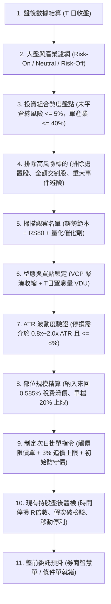
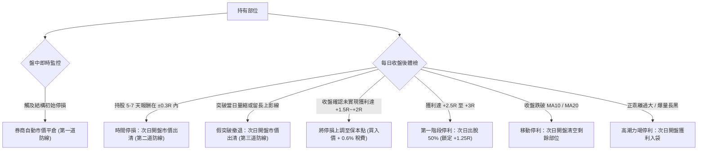

# 系統概述、風險聲明與每日盤後作業架構

> [!WARNING]
> **法律與風險免責聲明（Risk Disclaimer）**
> 本手冊為量化交易邏輯、規則引擎建置與波段操作之研究指導文件，**不構成任何個人投資建議、買賣推薦或獲利保證**。金融市場交易具備高度本金虧損風險，過去績效或回測假設不代表未來結果。使用者應自行評估財務狀況、獨立承擔交易風險，並於投入真實資金前完成充分的模擬交易與歷史驗證。

本手冊專為**「每日收盤後（End-of-Day, EOD）擬定次日作戰計畫」**所設計，適用標的為**台股普通上市櫃股票**（ETF、債券、權證因跳動單位、稅率與波動特徵不同，不適用本系統）。體系深度融合 Mark Minervini 的 SEPA®（特定買點分析）與 VCP（波動收縮形態）核心精髓，將大盤體質、基本面催化劑、量價結構與嚴密風控整合成客觀的數學公式與邏輯閘。

本手冊設計目的在於徹底消除盤中主觀情緒干擾，讓交易者在「夜間/盤後離線狀態」冷靜完成掃描、計算與設定，盤中全由券商條件單自動執行，同時可直接作為量化程式或 AI Agent 的交易決策規則引擎。

### 每日盤後標準作業流程（EOD Routine）



### 規則衝突與執行優先順序（Rule Priority Hierarchy）

當盤中或盤後多個訊號同時出現時，系統必須嚴格遵循以下優先順序執行，禁止人工主觀介入：

| 優先級 | 規則類別 | 觸發條件 | 執行動作 |
| :---: | :--- | :--- | :--- |
| **P0（最高）** | **系統性空頭斷路器** | 大盤連續 2 日判定為 Risk-Off | **全面禁止開立新倉**，取消所有次日買進掛單。 |
| **P1** | **初始結構硬停損** | 盤中價格觸及初始技術停損點 | **券商系統自動市價平倉**，不可猶豫，嚴禁向下放寬。 |
| **P2** | **假突破次日撤退** | 突破當日收盤量縮或留長上影線收破 Pivot | **次日開盤市價出清**，防範誘多套牢。 |
| **P3** | **時間停損（R 倍數）** | 進場 5–7 天報酬持續在 $\pm 0.3\text{R}$ 內停滯 | **次日開盤市價出清**，釋放資金與時間成本。 |
| **P4** | **高潮力竭噴出停利** | 爆量 3 倍均量長黑（非漲停）或正乖離 $> 50\%$ | **次日開盤出清剩餘部位**，賣在強勢中。 |
| **P5** | **趨勢破線移動停利** | 收盤跌破 MA10（動能）或 MA20（波段） | **次日開盤市價平倉剩餘部位**。 |
| **P6** | **目標倍數分批停利** | 盤後確認未實現獲利達 $+2.5\text{R}$ | **次日掛單賣出 50% 部位**，剩餘部位上移保本。 |

------------------------ 分隔線 ------------------------

# 核心數學原理、成本模型與部位風控

波段交易的利潤並非建立在預測行情的準確度，而是建立在**正數學期望值設計**與**非對稱下注機制**上。

## 期望值設計目標模型

$$\text{EV} = (P_{\text{win}} \times W) - (P_{\text{loss}} \times L) - C$$

* **$P_{\text{win}}$** : 系統勝率
* **$P_{\text{loss}}$** : 系統敗率（$1 - P_{\text{win}}$）
* **$W$** : 平均獲利金額
* **$L$** : 平均虧損金額
* **$C$** : 單筆交易整體摩擦成本（手續費、證交稅、滑價）

> [!NOTE]
> **期望值設計目標與勝率邊際警示**：
> 本系統以維持盈虧比 **$W / L \ge 2.5 : 1$** 為設計目標。
> - 在純理論無成本下，盈虧比 2.5:1 之損益兩平勝率約為 $28.6\%$。
> - 當勝率為 $40\%$ 時，期望值約為 $+0.40\text{R}$；但若勝率降至 $35\%$，期望值僅約 $+0.225\text{R}$，扣除台股摩擦成本後獲利邊際極薄。
> - 此外，因系統設計於 $+2.5\text{R}$ 出脫 50% 部位，剩餘部位跟隨均線移動，**實際平均獲利未必能剛好鎖定在 2.5R**。因此，「勝率 35%–40% 且 W/L 2.5:1」僅為策略規劃假設，必須依賴嚴謹的歷史回測與實盤交易紀錄持續驗證。

## 預計風險（Ex-Ante）與實際風險（Ex-Post）的關鍵認知

> [!CAUTION]
> **風控核心警示：停損價格不是保證成交價格！**
> 單筆交易以帳戶總資產的 1% 作為「預計風險預算（Ex-Ante Planned Risk）」。但**實際虧損（Ex-Post Actual Risk）仍可能因跳空開低、突發跌停鎖死、滑價、市場流動性不足與摩擦成本而超過 1%**。
> 台股具備每日 10% 漲跌幅限制，當個股開盤跳空跌停或盤中跌停鎖死時，停損單無法保證成交。因此，部位計算必須將成本與滑價直接納入分母，並設置投資組合總風險上限。

## 基準風險單位（R）與完整部位規模計算公式

基準風險單位（R-Multiple）中的 **1R** 代表單筆交易預計承擔的初始風險預算：
$$\text{帳戶 1R} = \text{總資本 } E \times 1\%$$
> 例如總資本為 1,000,000 元，單筆預計風險金額上限即為 $1\text{R} = 10,000$ 元。

### 1. 完整股數計算公式（計入成本與滑價）

為避免在理想公式下低估實際損失，可買進股數必須將每股手續費、證交稅與預估滑價納入分母計算：

$$N_{\text{raw}} = \left\lfloor \frac{\text{帳戶 1R}}{(P_e - P_s) + c + s} \right\rfloor$$

* **$P_e$**：預定買入價（樞紐點 $\text{Pivot} + 1\text{ Tick}$）。
* **$P_s$**：技術結構停損價（關鍵收縮低點 $- 1\text{ Tick}$）。
* **條件檢查**：程式必須檢驗 $P_e > P_s$，若 $P_e \le P_s$ 分母異常，強制阻斷交易。
* **$c$（每股來回交易成本預估）**：
  * 台股買進手續費率 $0.1425\%$，賣出手續費率 $0.1425\%$（合計 $0.285\%$，可乘上券商折扣係數如 6 折或 2.8 折）。
  * 賣出證券交易稅為 $0.3\%$。
  * 每股預估成本：$c \approx P_e \times (0.285\% \times \text{券商折扣} + 0.3\%)$。（以無折扣估計約為股價之 $0.585\%$）。
* **$s$（每股執行滑價預估）**：預設為進場與出場各估算 1 個跳動單位（Tick）之價格差。

### 2. 多重安全限制機制（Multiple-Cap Restriction）

計算出 $N_{\text{raw}}$ 後，最終核定下單股數必須同時受制於以下多重安全邊界：

1. **最大停損幅度門檻（Max Stop-Loss Cap）**：
   $$\text{停損幅度} = \frac{P_e - P_s}{P_e}$$
   若停損幅度 $> 8\%$（極限 $10\%$），**一律直接否決該筆交易**，禁止藉由縮小股數硬做防守距離過寬的標的。
2. **單一持股配置上限（Max Capital Allocation）**：
   單一標的投入金額上限為總資本的 **20%**（確保投資組合至少能分散於 5 檔標的）：
   $$N_{\text{capital}} = \left\lfloor \frac{\text{總資本} \times 20\%}{P_e} \right\rfloor$$
3. **可用現金與 T+2 交割款檢查（Cash Availability）**：
   $$N_{\text{cash}} = \left\lfloor \frac{\text{帳戶可用現金餘額}}{P_e \times 1.00585} \right\rfloor$$
   禁止在可用現金不足下依賴盤中當沖沖銷或未經規劃之融資下單，確保符合 T+2 日交割規範。
4. **投資組合整體未平倉總風險（Portfolio Heat 5% 上限）**：
   $$N_{\text{portfolio}} = \begin{cases} N_{\text{raw}}, & \text{若目前整體未平倉總風險 } + 1\% \le 5\% \\ 0, & \text{若加計後總風險 } > 5\% \text{（拒絕開新倉）} \end{cases}$$

**最終核定股數**：
$$N = \min\left(N_{\text{raw}}, \; N_{\text{capital}}, \; N_{\text{cash}}, \; N_{\text{portfolio}}\right)$$

### 3. 台股在地化整張與零股取整規範
* **整張交易模式（預設）**：向下取整至最接近的千股整數：
  $$N_{\text{order}} = \left\lfloor \frac{N}{1000} \right\rfloor \times 1000$$
* **盤中零股模式**：若帳戶資金較小，整張計算為 0 股，則改採盤中零股委託，直接使用 $N$ 股下單。

## 投資組合總熱度（Portfolio Heat）與產業集中度限制

當同時持有複數標的時，帳戶的整體未平倉總風險定義為：

$$\text{Portfolio Heat} = \sum_{i=1}^{k} \frac{N_i \times (P_{e,i} - P_{\text{stop},i}) + \text{預估成本}_i}{\text{總資本}}$$

* **風險釋放機制**：當某檔持股的停損點已成功上移至損益兩平點以上（$P_{\text{stop}} \ge P_e$），該筆持股承擔的「未平倉風險」歸零，釋放出 1% 的風險配額。
* **硬性斷路門檻**：當 $\text{Portfolio Heat} \ge 5\%$ 時，**系統全面拒絕任何新標的的開倉掛單**，直到既有持股獲利拉開並上調停損釋放額度。
* **產業與族群集中度上限（Sector Cap）**：
  * 單一特定產業（例如半導體類股、電子零組件）合計持倉市值**不得超過總資產的 40%**。
  * 防範台股常見的電子族群連動系統性重挫，避免單日產業大回檔同時觸發多檔停損。

## 帳戶回撤控制與連續虧損停手機制（Drawdown Control）

1. **連續虧損降注（Loss Cutback）**：
   - 若最近 2 筆交易連續觸發停損，強制將每筆風險預算降為 **0.5R**。
   - 若最近 3 筆交易連續觸發停損，**次日開倉配額歸零**，全面暫停建立新部位 3~5 天（休眠期），等待市場體質重新轉佳。
2. **整體淨值回撤保護（Portfolio Drawdown Rule）**：
   - 當帳戶淨值自歷史高點回撤達 **10%** 時，所有部位規模上限減半（單檔上限降至 10%，單筆風險降至 0.5%）。
   - 直到帳戶淨值重新創下近 30 個交易日新高，始得恢復標準風險參數。

------------------------ 分隔線 ------------------------

# 市場環境過濾機制（市場體質與產業分層）

股票市場中約 70% 至 75% 的個股價格波動受市場環境與產業週期的系統性關聯影響。盤後確認大盤狀態是決定次日是否允許開倉的第一道最高優先級開關。

## 市場觀測標的分層架構

* **全市場廣泛指數（Broad Market Index）**：
  * **台股**：台灣加權指數（`TWSE:TAIEX`）為主，櫃買指數（`TPEX:TPEx`）為輔。
  * **美股**：標普 500 指數（`SPY`）或那斯達克 100 指數（`QQQ`）。（**禁止使用 SOX 作為全美股通用的市場濾網**）。
* **特定產業指數（Sector Index）**：
  * 費城半導體指數（`SOX`）僅作為「半導體與電子零組件族群」的二級產業環境濾網，非半導體類股不受 SOX 約束。

## 市場環境三態、均線斜率與切換緩衝機制

為避免指數在均線邊界震盪時造成頻繁切換（Whipsaw），系統設定「連續 2 日確認」緩衝機制：

| 市場環境狀態 | 技術指標判定標準（需連續 2 日收盤確認） | 次日操作權限與核心戰略行動 |
| :--- | :--- | :--- |
| **多頭攻擊 (Risk-On)** | 1. 指數收盤價高於 MA20 與 MA60。<br>2. **MA20 與 MA60 斜率皆向上或走平**。 | **全速運作**。<br>允許建立新倉，積極挑選符合 VCP 樞紐突破之領導標的。 |
| **中性震盪 (Neutral)** | 1. 指數處於 MA20 與 MA60 之間；或<br>2. 指數站上均線但均線下彎走平。 | **防守型試單**。<br>次日僅限開立 1 檔極高標準試單（0.5R），保留至少 50% 現金。 |
| **空頭防守 (Risk-Off)** | 1. 指數收盤跌破 MA20 且 MA20 下彎；或<br>2. 指數收盤跌破 MA60。 | **全面禁止建立新多單**。<br>取消所有次日買進委託，現有持股啟動客觀防禦程序。 |

## Risk-Off 時現有持股的客觀處置規則

當大盤觸發 Risk-Off 時，現有持股不可隨意臨場發揮，必須依當前股價客觀執行：

* **狀況 A（持股已脫離成本，現價 > 買入成本）**：
  * 將移動停損單立刻上調至「買進成本價 + 交易摩擦成本」（保本點），或收緊至 **MA10**，防止浮盈回吐為虧損。
* **狀況 B（持股在成本附近或小幅套牢，現價 $\le$ 買入成本）**：
  * **嚴禁將停損單設在成本價**（因現價已低於成本，此掛單不合邏輯且無防護力）。
  * **執行動作**：維持原始設定的「技術結構硬停損點」，或者主動執行**「防守性減碼出脫 50% 部位」**，收回現金並縮減風險敞口，若跌破原始技術點則堅決全數砍單，嚴禁凹單攤平。

------------------------ 分隔線 ------------------------

# 盤後候選觀察名單篩選機制

交易決策採取嚴格的兩階段流程：**今晚盤後先建立候選觀察名單，明盤僅在觸發點精確引爆**。

## 量化篩選條件

盤後掃描全市場股票池，同時滿足以下條件者列入「候選觀察名單」：

### 1. 流動性門檻與標的排除條件
* **標的限制**：僅限台灣證券交易所與櫃買中心之**普通股票**（排除 ETF、權證、特別股）。
* **排除高風險股**：**絕對排除**處置股、注意股、管理股票、全額交割股（變更交易方法股票）以及半年內面臨減資彌補虧損之標的。
* **成交量門檻**：近 20 日平均成交量超過 **2,000 張**（美股標的超過 1,000,000 股）。

### 2. 趨勢範本（Trend Template）完整準則
* 現價位於 **MA60**（季線）與 **MA240**（年線）之上。
* MA60 高於 MA240（中長期多頭排列）。
* MA240 近 20 日斜率向上或止跌走平。
* **距離 52 週最低點至少上漲 30% 以上**（確保已徹底脫離第一階段 Stage 1 築底期，正式進入第二階段 Stage 2 飆升趨勢）。
* **距離 52 週最高點差距在 25% 以內**（強者恆強，過濾深幅套牢弱勢股）。

### 3. 相對強度評分（Relative Strength, RS Rating）
* **量化定義**：採 12 個月績效加權百分位排名（Percentile Rank）：
  $$\text{RS Score} = (0.4 \times R_{3m}) + (0.2 \times R_{6m}) + (0.2 \times R_{9m}) + (0.2 \times R_{12m})$$
* **門檻要求**：**RS Rating $\ge 80$**（代表績效擊敗全市場 80% 以上標的，鎖定產業領頭羊）。

### 4. 基本面催化劑（明確量化定義，至少符合一項）
* **季報盈餘動能**：最新單季 EPS **年增率（YoY）$\ge 20\%$**，或連續兩季加速成長。
* **月營收加速動能**：連續 2 個月營收年增率由負轉正，或**本月營收年增率大於上月營收年增率至少 5 個百分點（成長斜率明確擴大）**。
* **法人籌碼認養**：近 10 個交易日內，投信或外資出現**至少連續 3 日淨買超**，且累計買超張數佔股本顯著。
*(註：若為美股標的，可納入「最新公布財報 EPS 超出分析師預期（PEAD Surprise）$\ge 10\%$」)*。

### 5. 重大事件與財報避險窗口（Blackout Window）
* **財報公布前 4 個交易日**：禁止建立該個股的新多單，不參與不可控的財報跳空賭博。
* **除權息、增資或法說會日前 3 個交易日**：若未累積至少 +2R 以上的獲利緩衝墊，禁止新開倉或重倉持股跨越事件日。

## 查詢途徑
* **台股 RS Rating 排行榜**：[https://twrs.tw/](https://twrs.tw/)
* **蘇家禹 Jack Su 上市櫃 RS 評分**：[https://www.jacksu.tw/tool/stock/tw-rs-rating](https://www.jacksu.tw/tool/stock/tw-rs-rating)
* **TradingView 圖表**：[https://tw.tradingview.com/](https://tw.tradingview.com/)（疊加社群指標 `Minervini RS`，基準設為 `TWSE:TAIEX`）。

------------------------ 分隔線 ------------------------

# 進場型態確認與次日掛單規劃

盤後鎖定兩大高期望值進場型態：**「波動收縮突破（VCP）」**用於捕捉長期盤整結束後的動能爆發點；**「關鍵均線回踩（MA20 Pullback）」**用於捕捉強勁上升趨勢中的中繼上車點。

## 形態 A：波動收縮突破（VCP）

股價在維持長期多頭排列下進入橫盤整理，每次回檔幅度與成交量隨時間推移逐級收斂。

```
[VCP 波動收縮結構圖解]
價格
 |      T1 (回檔 15-25%)
 |      \          /   T2 (回檔 7-12%)
 |       \        /     \      /   T3 (最後微幅收縮 2-5%)
 |        \      /       \    /     \  /  <-- 樞紐買點 (Pivot Point)
 |         \____/         \__/       \/   <-- 最後結構收縮低點 (停損點)
 |
成交量 ----------------------------------------------------
 |       ||||||          ||||         ||  <-- 窒息萎縮量 (VDU)
+------------------------------------------------------------> 時間
```

### 1. 收縮區量化特徵
* **收縮次數**：至少經歷 **2 次收縮（T1, T2）**，通常為 3 至 4 次（T1, T2, T3）。
* **幅度收斂量化**：後一次回檔幅度必須小於前一次的 60%（即 $\text{Depth}(T_n) \le 0.6 \times \text{Depth}(T_{n-1})$），最後緊湊收縮區（Handle）波動壓縮至 2%–5% 之間。

### 2. T 日（今晚盤後）關鍵檢驗：窒息萎縮量（Volume Dry Up, VDU）
* **今日收盤量能**：最後一次緊湊收縮區內，**今日成交量必須低於 20 日均量的 50%（或創下數週新低量）**。
* **意義**：證明浮動籌碼已被完全洗淨，市場進入無人想賣的真空狀態，極易被主力買盤推升。

### 3. 樞紐買點（Pivot Point）與技術停損點定義
* **樞紐買點（Pivot Point）**：取**最後一次微幅收縮區（T3 / Handle）的最高點**（注意：並非數月前的大基底最高點！）。
* **次日掛單觸發價**：$\text{Pivot Point} + 1 \text{ Tick}$。
* **技術結構停損點**：取最後一次微幅收縮區的**最低日 K 低點**向下扣除 1 個 Tick。

### 4. ATR 波動度合理性檢驗（Volatility Noise Filter）
> [!IMPORTANT]
> **停損點與 ATR 的正確互動方式**：
> 停損點位**必須由技術結構失效點決定**，不可隨意用 ATR 停損硬切在結構中間。ATR 在本系統中專門作為**「波動度濾網」**：
> 1. **防止停損過緊（雜訊過濾）**：若 $(\text{Pivot} - \text{Stop}) < 0.8 \times \text{ATR}(14)$，代表防守點落於日常隨機雜訊內，極易被洗出場。此時必須**強制將停損點外推至 $\text{Pivot} - 1.0 \times \text{ATR}(14)$**，或放棄此交易。
> 2. **防止停損過寬（形態過寬過濾）**：若 $(\text{Pivot} - \text{Stop}) > 2.0 \times \text{ATR}(14)$ 或停損幅度 $> 8\%$，代表該標的波動尚未充分收縮，**直接放棄該交易，禁止進場**。

### 5. 台股最小跳動單位（Tick）與跨級距取整表
* **未滿 10 元** : 0.01 元
* **10 元至未滿 50 元** : 0.05 元
* **50 元至未滿 100 元** : 0.1 元
* **100 元至未滿 500 元** : 0.5 元
* **500 元至未滿 1,000 元** : 1 元
* **1,000 元以上** : 5 元

> [!NOTE]
> **跨級距停損價計算防呆**：
> 見上表所示。當價格落在邊界時（例如買入價 101 元，停損扣 1.5 元為 99.5 元），程式計算 Tick 減項時必須依據該價格所屬之法規級距取整，確保委託價格為合法報價單位。

## 形態 B：關鍵均線回踩確認（MA20 Pullback）

* **型態特徵**：強勢飆股沿 MA20 推升，隨後出現連續 3 至 5 天的量縮回檔測試 MA20 支撐。
* **今晚確認量化門檻**：
  * **長下影線止跌**：回踩 MA20 當日收盤守於 MA20 上，且下影線長度 $\ge$ 實體長度的 1.5 倍（或下影線佔全日振幅 $50\%$ 以上）。
  * **吞噬陽線止跌**：今日陽線實體完全吞噬前一日陰線實體，且收盤價高於前一日最高價。
* **次日掛單觸發價**：今日（回踩止跌日）的高點 $+ 1 \text{ Tick}$。
* **防守停損點**：今日回踩形成的波段低點下方 1 個 Tick。

## 次日盤前掛單規範（智慧單防呆原則）

在今晚產出明天的券商預掛單指令時，必須嚴格遵守以下執行條件：

1. **委託類型**：一律使用**「觸價限價單（Stop Limit）」**，絕不使用市價單盲目追高。
2. **禁止過度追價上限（Max Chase Rule）**：
   $$\text{委託上限價} = \text{Pivot 買點} \times 1.03$$
   若明日開盤受突發消息跳空高開 $> 3\%$，或是直接跳空漲停鎖死，**該筆掛單自動作廢／撤單**，嚴防「追在當天最高點」的滑價風險。
3. **初始停損單同步預設**：買單成交後，券商系統必須立即同步啟動觸價停損單。

------------------------ 分隔線 ------------------------

# 出場防線與持股動態管理（盤後審查與次日執行）

出場機制區分為**「盤中券商全自動防守」**與**「盤後離線審查、次日開盤執行」**兩個維度，徹底解放看盤精力。



## 第一道防線：初始硬停損（盤中券商自動執行）

* **執行時機**：買進成交後立即生效，盤中由券商伺服器 100% 自動盯盤。
* **停損點位**：嚴格設於「技術結構收縮低點 $- 1\text{ Tick}$」（且符合 ATR 濾網檢驗）。
* **鐵血紀律**：初始停損價建立後，**只准向上移動以保護獲利，嚴禁任何向下放寬停損的行為**。一旦盤中觸發，無條件認賠出場。
* **跌停鎖死應變規範**：若遇突發重大利空直接跳空跌停鎖死無法成交，次日早盤 8:30 前必須掛出跌停市價單排隊出清，嚴禁心存僥倖抱單。

## 第二道防線：時間停損（R 倍數精確量化，次日開盤執行）

* **檢核時機**：進場後 **第 5 至 7 個交易日** 的收盤後。
* **精確判斷條件**：以 R 倍數衡量，若標的股價在 5 至 7 天內始終未能拉出獲利，未實現損益持續在 **$\pm 0.3\text{R}$** 泥淖中震盪徘徊。
  * （相較於固定百分比，以 $\pm 0.3\text{R}$ 為門檻能精確適配不同波動度之股票，例如 1R 為 5% 則門檻為 $\pm 1.5\%$；1R 為 2% 則門檻為 $\pm 0.6\%$）。
* **執行動作**：**於次日開盤直接市價平倉**。
* **背後原理**：真正的高動能突破通常在 3 天內就會脫離成本區。若原地踏步代表動能不足，應主動撤出資金與時間成本，將部位轉移至下一檔更強勢的標的。

## 第三道防線：突破次日假突破檢驗（次日開盤執行）

* **檢核時機**：進場突破當日（T 日）的收盤後。
* **警示現象**：
  - 當天收盤成交量**未達 20 日均量的 1.2 倍**（量縮假突破）；或者
  - 收盤留下長上影線、股價收在 Pivot 買點之下（該漲不漲）。
* **執行動作**：判定為高機率誘多陷阱，無須等待跌破原始停損點，**於次日開盤直接出清部位**。

## 第四道防線：複合移動停利與波段追蹤

將持股部位切分，同時兼顧「勝率維持」、「落袋為安」與「大波段利潤奔馳」。

### 1. 損益兩平保護（Breakeven Stop）
* **觸發時機**：今晚盤後確認日線收盤未實現獲利達到 **$+1.5\text{R}$ 至 $+2.0\text{R}$**（或個股拉回測試支撐後再創波段新高）。
* **執行動作**：將券商端的移動停損點上移至**「買進成本價 + 交易摩擦成本（約買入價 $+0.6\% \sim +0.8\%$）」**，確保整筆交易本金立於不敗之地。
> [!NOTE]
> **禁止過早保本**：嚴禁在僅達到 +1R 時過早移動至成本價，避免被正常的突破後自然回測（Throwback）假性洗出場，導致勝率嚴重受損。

### 2. 第一階段部分停利（+2.5R 至 +3R）與實質實現 R 值精算
* **觸發時機**：股價達到 **$+2.5\text{R}$ 至 $+3\text{R}$** 目標區。
* **執行動作**：**次日掛單賣出 50% 部位（固定比例 0.5）**。
* **實質實現 R 倍數試算（假設原始 1R 為 10,000 元）**：
  * 當股價上漲至 +2.5R 時賣出 50% 部位，該筆分批賣出所**實際實現的獲利為 $+1.25\text{R}$**（約 12,500 元，未扣稅費），**並非整筆交易獲利 2.5R**。
  * 此時將剩餘 50% 部位之停損移至保本點。若後續剩餘部位不幸在保本點平倉，該筆交易最終實現淨獲利仍固定鎖定在 **$+1.25\text{R}$**。

### 3. 第二階段趨勢奔馳（移動防守雙軌制）
剩餘 50% 部位不預設獲利上限，系統依據「速度與動能強度」自動判定並切換防守均線：

* **【模式 A：中期穩健波段（Swing Mode，系統預設）】**：
  * **適用情境**：所有標的進場後的預設模式，適用於正常階梯式推升之波段。給予股價回測 MA10 的正常呼吸空間。
  * **出場訊號**：日線收盤價跌破 **MA20**，次日開盤市價出清。
* **【模式 B：極強動能波段（Momentum Mode，動態升級）】**：
  * **自動升級判定條件（盤後檢視，符合任一即觸發升級）**：
    1. **速度爆發（Velocity）**：進場後 7 個交易日內，未實現獲利達到 $+2.5\text{R}$ 以上（或短線漲幅 $> 15\%$）。
    2. **乖離過大（Extension）**：今日收盤價與 MA20 的正乖離率 $\ge 12\%$（$\text{BIAS}_{\text{MA20}} = \frac{\text{現價} - \text{MA20}}{\text{MA20}} \ge 12\%$）。
    3. **均線懸空（Suspension）**：連續 5 個交易日 K 線完全懸空於 MA10 之上推升（均線斜率 $> 45^\circ$）。
  * **出場訊號**：一旦觸發升級，防守線強制收緊至 **MA10**。日線收盤價跌破 **MA10**，次日開盤市價出清，鎖定暴利，防止大波段利潤大幅回吐。

### 4. 高潮力竭噴出主動停利（Climax / Exhaustion Top）
超級飆股在波段末端常出現連續跳空急噴，若等待跌破均線往往已大幅回吐獲利。
* **觸發條件（符合任一）**：
  1. 股價與 MA60 的正乖離率超過 **50%**。
  2. 出現連續 3 天跳空急漲、日線 RSI(14) 突破 **85**。
  3. 單日出現成交量達 20 日均量 **3 倍以上** 的爆量長黑棒或高檔長避雷針（長上影線）。（**排除漲停鎖死**：若單日漲停鎖死即便爆量亦不視為力竭，只有「爆量打開收低或長黑」才符合條件）。
* **執行動作**：**次日開盤主動出清剩餘所有部位**，達成「賣在強勢中（Selling into Strength）」。

------------------------ 分隔線 ------------------------

# 交易紀錄、績效檢討與回測驗證規範

一套規則可以被機械化執行，並不等同於已經被證明具備長期正期望值。在投入真實大資金運作前，必須明確區分「設計假設」與「驗證標準」，並建立客觀的交易紀錄與回測檢驗。

## 交易日誌標準紀錄表（Audit Log Schema）

每筆交易必須在盤後完整填寫以下標準數據，定期檢討系統表現：

| 欄位名稱 | 說明與格式 | 範例 |
| :--- | :--- | :--- |
| **交易代碼與名稱** | 標的代號與股票名稱 | 2330 台積電 |
| **進場日期與型態** | 買進成交日期與進場設置 | 2026-10-18 (VCP T3 Breakout) |
| **預定進場價 / 實買價** | 樞紐點預定價 vs 實際成交價（檢驗滑價） | 1005 元 / 1005 元 (滑價 0) |
| **初始停損價 / 每股 1R** | 技術結構低點與每股承擔之 1R 差距 | 960 元 (每股 1R = 45 元) |
| **核定買進股數** | 考量 1R、單檔 20% 與可用資金後之股數 | 1,000 股 (1 張) |
| **實際出場日期與原因** | 平倉日期與出場防線代碼 (P1~P6) | 2026-11-05 (P6 目標停利 + P5 跌破 MA10) |
| **實際平倉價** | 實際成交平倉價格 | 1120 元 (前 50%) / 1080 元 (後 50%) |
| **已實現 R 倍數** | 扣除所有摩擦成本後之淨 R 倍數 | **+1.85 R** |
| **持股交易日數** | 總持有日數 | 14 天 |

## 量化回測與實盤驗證標準（CFA Institute 方法論）

任何針對本系統之歷史回測與量化腳本開發，必須嚴格納入以下要素：

* **完整摩擦成本模型**：每筆來回必須扣除台股手續費（依折扣）、證券交易稅（0.3%）與至少 1 個 Tick 的進出滑價，輸出「毛報酬」與「淨報酬」對照表。
* **嚴禁前視偏差（No Look-Ahead Bias）**：
  * 盤後篩選只能使用 T 日收盤時點已完全公開之價格、營收與季報資料。
  * 財報公告日期必須依實際申報時戳為準，不得將 Q3 財報日期直接套用於 9 月 30 日（實務申報截止日為 11 月 14 日）。
* **防範倖存者偏差（Survivorship-Bias Free）**：股票池必須包含歷史上曾經上市櫃但後續下市、遭併購或變更交易方法之股票。
* **樣本外測試（Out-of-Sample Testing）**：
  * 將歷史資料劃分為訓練期（In-Sample，如 2015–2021 年）與樣本外驗證期（Out-of-Sample，如 2022–2025 年）。
  * 分別獨立檢驗在多頭市場（如 2020–2021）、大空頭市場（如 2022）與劇烈震盪盤整市場（如 2023 初）之系統抗壓性與最大回撤（Max Drawdown）。

------------------------ 分隔線 ------------------------

# AI 交易規則引擎設定檔（JSON 規格）

本系統整合至 AI 工具或自動化腳本時，所有輸入數據均為**「當日收盤結算資料（EOD Data）」**，輸出的戰術指令為**「次日盤前具體掛單清單」**。
設定檔參數與正文規範 **100% 完全統一**。

```json
{
  "system_config": {
    "system_mode": "EOD_PLANNING_FOR_NEXT_DAY",
    "target_horizon_days": [1, 90],
    "account_risk_limit_pct": 0.01,
    "max_portfolio_risk_pct": 0.05,
    "max_single_position_pct": 0.20,
    "max_sector_concentration_pct": 0.40,
    "max_allowable_stop_pct": 0.08,
    "max_chase_pivot_pct": 0.03,
    "transaction_cost_estimate_pct": 0.00585,
    "estimated_slippage_ticks": 1,
    "drawdown_control": {
      "consecutive_losses_risk_cut_pct": 0.005,
      "consecutive_losses_pause_threshold": 3,
      "portfolio_drawdown_half_size_pct": 0.10
    }
  },
  "market_regime_filter": {
    "broad_market_symbols": {
      "tw": "TWSE:TAIEX",
      "us": "INDEX:SPY"
    },
    "sector_specific_filters": {
      "semiconductor": "INDEX:SOX"
    },
    "require_close_gt_ma20": true,
    "require_close_gt_ma60": true,
    "require_ma20_slope_gte": 0.0,
    "require_ma60_slope_gte": 0.0,
    "regime_confirmation_buffer_days": 2,
    "action_if_false": "BLOCK_ALL_NEW_BUYS"
  },
  "watchlist_criteria": {
    "eligible_security_types": ["TW_COMMON_STOCK"],
    "exclude_warning_and_disposition_stocks": true,
    "min_avg_volume_20d_tw": 2000,
    "min_avg_volume_20d_us": 1000000,
    "min_rs_rating": 80,
    "trend_template": {
      "close_gt_ma60": true,
      "close_gt_ma240": true,
      "ma60_gt_ma240": true,
      "ma240_slope_20d_gte": 0.0,
      "distance_from_52w_high_max_pct": 0.25,
      "distance_from_52w_low_min_pct": 0.30
    },
    "catalyst_any_of": [
      "eps_yoy_gte_20",
      "rev_yoy_expansion_min_percentage_points_gte_5",
      "institutional_net_buy_streak_gte_3"
    ],
    "event_blackout_days_before_earnings": 4,
    "event_blackout_days_before_ex_dividend": 3
  },
  "entry_triggers": {
    "setup_A_vcp": {
      "min_contractions": 2,
      "contraction_depth_decay_ratio": 0.60,
      "today_volume_dry_up_max_ma20_ratio": 0.50,
      "pivot_definition": "final_contraction_high",
      "trigger_price_offset": "+1_tick",
      "stop_loss_reference": "final_contraction_low - 1_tick",
      "atr_noise_filter": {
        "min_stop_distance_atr_mult": 0.80,
        "max_stop_distance_atr_mult": 2.00
      }
    },
    "setup_B_pullback": {
      "reference_ma": "MA20",
      "max_pullback_bars": 5,
      "trigger_price_offset": "pullback_candle_high + 1_tick",
      "stop_loss_reference": "pullback_swing_low - 1_tick",
      "reversal_candle_min_lower_shadow_ratio": 1.5
    }
  },
  "execution_sizing": {
    "formula_denominator": "(Entry_Price - Stop_Loss_Price) + (Entry_Price * transaction_cost_estimate_pct) + (estimated_slippage_ticks * tick_size)",
    "risk_shares": "Math.floor((Total_Equity * 0.01) / formula_denominator)",
    "capital_shares": "Math.floor((Total_Equity * 0.20) / Entry_Price)",
    "cash_shares": "Math.floor(Available_Cash / (Entry_Price * 1.00585))",
    "portfolio_heat_allowance": "(Total_Equity * (0.05 - Current_Open_Risk_Pct)) / formula_denominator",
    "final_shares": "Math.max(0, Math.min(risk_shares, capital_shares, cash_shares, portfolio_heat_allowance))",
    "tw_odd_lot_rule": "ROUND_DOWN_TO_1000_OR_USE_ODD_LOT"
  },
  "exit_rules": {
    "initial_stop": "Technical_Low_Minus_Tick",
    "time_stop": {
      "max_bars_held": 7,
      "stagnant_threshold_r_multiple": 0.30,
      "action": "SELL_MARKET_AT_NEXT_OPEN"
    },
    "post_breakout_validation": {
      "min_breakout_volume_ratio": 1.20,
      "require_close_gt_pivot": true,
      "action_if_failed": "EXIT_AT_NEXT_OPEN"
    },
    "partial_take_profit": {
      "at_r_multiple": 2.5,
      "close_fraction": 0.5,
      "realized_r_multiple": 1.25
    },
    "trailing_stop": {
      "move_to_breakeven_at_r_range": [1.5, 2.0],
      "default_mode": "SWING_MA20",
      "momentum_upgrade_triggers": {
        "max_days_to_reach_2_5r": 7,
        "ma20_bias_extension_pct_gte": 0.12,
        "min_bars_above_ma10": 5
      },
      "momentum_exit_ma": "MA10",
      "trend_exit_ma": "MA20",
      "climax_ma60_extension_pct": 0.50,
      "climax_volume_exhaustion_ratio": 3.0
    }
  }
}
```

------------------------ 分隔線 ------------------------

# 交易執行前客觀檢核表（盤後填寫與拒絕原因碼）

在今晚確認產出明日券商委託單前，必須依序核對以下各項客觀事實。若任一項目未通過，系統立即終止該筆交易計畫並標註相應之**「拒絕原因代碼（Rejection Code）」**：

### 檢核清單與錯誤代碼對照表

| 檢核項目 | 客觀檢驗條件 | 未通過時之處置與原因代碼 |
| :--- | :--- | :--- |
| **1. 大盤體質** | 加權指數站於 MA20 與 MA60 之上且均線斜率向上（連續 2 日確認）。 | ❌ 拒絕開倉：`ERR_MARKET_REGIME_RISK_OFF` |
| **2. 總風險熱度** | 當前已開立部位總風險加計新單 $\le 5\%$。 | ❌ 拒絕開倉：`ERR_PORTFOLIO_HEAT_EXCEEDED` |
| **3. 產業集中度** | 該特定產業合計持倉市值加計新單 $\le 40\%$。 | ❌ 拒絕開倉：`ERR_SECTOR_CONCENTRATION_EXCEEDED` |
| **4. 標的資格與事件** | 為普通股票，非處置股/全額交割股，距財報公告 $> 4$ 日且距除息 $> 3$ 日。 | ❌ 拒絕開倉：`ERR_INELIGIBLE_OR_EVENT_BLACKOUT` |
| **5. 標的趨勢範本** | 現價高於 MA60/240、距 52 週低點 $> 30\%$ 且高點 $< 25\%$。 | ❌ 剔除觀察名單：`ERR_TREND_TEMPLATE_FAIL` |
| **6. 基本面催化劑** | 具備單季 EPS YoY $\ge 20\%$、月營收斜率擴大 $\ge 5\%$ 或法人連 3 日買超。 | ❌ 剔除觀察名單：`ERR_NO_FUNDAMENTAL_CATALYST` |
| **7. 窒息萎縮量 (VDU)** | 今日收盤成交量低於 20 日均量的 50%（或創數週新低）。 | ❌ 不符合明日買點：`ERR_VOLUME_NOT_DRIED_UP` |
| **8. ATR 雜訊與停損** | 停損差距介於 $0.8 \times \text{ATR}$ 至 $2.0 \times \text{ATR}$ 之間，且停損幅度 $\le 8\%$。 | ❌ 形態不良放棄交易：`ERR_STOP_LOSS_VIOLATES_ATR_OR_8PCT` |
| **9. 部位規模精算** | 已套用成本、滑價、單檔 20%、現金與 1R 風險公式計算股數。 | ❌ 計算異常阻斷：`ERR_SIZING_CALCULATION_INVALID` |
| **10. 委託單防呆** | 設定 Pivot $+ 1\text{ Tick}$ 觸價限價單，且追價上限為 $+3\%$。 | ❌ 掛單條件不符：`ERR_ORDER_SETUP_NON_COMPLIANT` |

---

### 次日委託單標準產出格式（範例）

當上述 10 項檢核全數通過（✅ APPROVED）後，系統始得產出次日掛單指令：

```markdown
【次日預備交易指令單】
- 標的代號：2330 台積電
- 檢核狀態：✅ 全數核准 (Approved)
- 進場型態：VCP 最後收縮突破 (Setup A)
- 觸價買進價 (Pivot + 1 Tick)：1,005 元
- 委託上限價 (Max Chase +3%)：1,035 元 (超過即取消掛單)
- 初始結構停損價：960 元 (距離買入價 4.47% <= 8%，且介於 0.8x~2.0x ATR)
- 預估每股風險 (含來回 0.585% 稅費與滑價)：51.2 元
- 核定委託股數：1,000 股 (1 張，佔總資金 19.5% <= 20%，符合可用現金 T+2 交割)
- 盤中券商條件單：成交後立即自動掛出「960 元觸價停損賣出單」
```