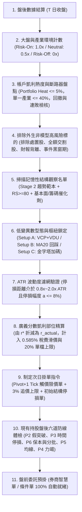

# 凱利公式波段交易體系：統計優勢、SEPA® 結構與對數複利控倉指南

> [!WARNING]
> **法律與風險免責聲明（Risk Disclaimer）**
> 本文件為量化交易理論、統計風險模型、規則引擎建置與波段操作之學術與實務研究指導文件，**不構成任何個人投資建議、買賣推薦或獲利保證**。金融市場交易具備高度本金虧損與肥尾黑天鵝風險，過去績效或回測參數不代表未來結果。使用者應自行評估財務狀況、獨立承擔交易風險，並於投入真實資金前完成充分的樣本外回測與模擬驗證。

---

## 第一章：理論總綱——當索普「算牌統計學」遇見米奈爾維尼「SEPA® 波段體系」

### 1.1 導論：為何必須將「凱利統計學」與「SEPA® 波段技術」深度融合？
在現代股票市場中，單純掌握技術型態（如突破買進）卻缺乏嚴密資金控管的交易員，往往在遭遇市場結構轉換（Regime Shift）或連續停損時，因**「過度重倉（Overbetting）」**與**「波動拖累（Volatility Drag）」**而走向慢性破產；反之，單純套用凱利公式（Kelly Criterion）卻缺乏微觀價格結構與基本面催化認知的量化交易者，則容易在無記憶性的隨機雜訊區中過度交易，或因忽略隔夜跳空與停損滑價而慘遭斷頭。

本體系將量化先驅**愛德華·索普（Edward Thorp）的「條件機率算牌邏輯與廣義分數凱利公式」**，與全美投資冠軍**馬克·米奈爾維尼（Mark Minervini）的「SEPA® 特定買點分析與 VCP 波動收縮形態」**徹底融合，建構出一套專為**台股普通上市櫃股票（並相容美股市場）**設計、於**每日收盤後（End-of-Day, EOD）離線決策、次日盤中全自動執行**的防禦型波段交易理論：

* **米奈爾維尼的 SEPA® 與 VCP 解決了「何時與何處存在正期望值（Where is the Edge?）」**：
  透過大盤環境濾網、第二階段趨勢範本（Stage 2 Trend Template）、相對強度（RS $\ge 80$）、基本面催化劑與 VCP 窒息量（VDU），將股票市場從「隨機漫步雜訊區」過濾至供給枯竭、需求即將引爆的**「記憶性結構區」**，創造高條件勝率（$p$）、高盈虧比（$B$）與極低初始波動變異數（$\sigma^2$）的不對稱切入點。
* **索普的廣義分數凱利公式解決了「該下多少注與如何動態控倉（How Much to Bet?）」**：
  在確認正期望值後，透過離散型廣義凱利公式（$r^* = p - \frac{q}{B}$ 與 $f^* = \frac{r^*}{a}$）及連續時間凱利公式（$f^* \approx \frac{\mu - r_f}{\sigma^2}$），結合台股交易摩擦成本（手續費、證交稅、滑價）、多重安全上限（Multiple-Cap）與在險資金熱度（Portfolio Heat），在消除破產風險（確保遍歷性存活）的前提下，實現單一時間線上的長期對數幾何複利極大化。

---

### 1.2 股市結構二分法：無記憶性雜訊區 vs. 記憶性結構區
從隨機過程與市場微觀結構的角度來看，股市交易環境可嚴格區分為兩大狀態：

1. **無記憶性雜訊區（Random Walk Noise Regime）**：
   當大盤處於空頭逆風，或個股處於第一階段（Stage 1）無量能配合、無基本面催化的箱型隨機震盪期，其短期價格跳動近似於「獨立同分佈（i.i.d.）」的隨機漫步（如同美式輪盤）。在扣除台股單次來回摩擦成本（手續費 $0.285\% \times \text{折扣}$ ＋ 證交稅 $0.3\%$ ＋ 滑價，合計約 $0.4\% \sim 0.6\%$）後，頻繁交易的單次數學期望值恆為負值：
   $$E[X] = (1 \times p) + (-1 \times q) - \text{交易摩擦成本} < 0$$
   在此區域內，任何「向下攤平（Averaging Down）」本質上皆是賭場中的**馬丁格爾加倍投注法（Martingale System）**——僅是將多次小額停損掩蓋起來，轉化為一次足以讓帳戶重倉套牢或斷頭歸零的極端左尾事件，完全無法扭轉期望值為負的數學本質。
2. **記憶性結構區（Memory Structure & SEPA® Price Dislocation）**：
   當個股受到**機構法人建倉的時間延續性、投資人行為偏誤（處置效應與錨定效應）、籌碼供需失衡以及波動率聚集效應（Volatility Clustering）**影響時，股價會呈現強烈的狀態轉移記憶性（馬可夫過程）。當個股完成長期浮額清洗（VCP 壓縮與 VDU 窒息量）並伴隨基本面催化劑放量突破樞紐點（Pivot Point）時，條件勝率（$p$）與潛在盈虧比（$B$）將顯著轉向有利於交易者的一方。

| 系統維度 | 股市無記憶性雜訊區（Stage 1 盤整 / Stage 4 空頭 / 盲目當沖） | 股市記憶性結構區（Stage 2 趨勢 + SEPA® 催化 + VCP 突破） |
| :--- | :--- | :--- |
| **機率分佈特性** | 近似獨立同分佈（i.i.d.）隨機漫步，多空機率接近 50/50 | 具狀態轉移記憶性，法人籌碼鎖定與浮額枯竭改變條件機率 |
| **部位策略效用** | 向下攤平（馬丁格爾）僅重排虧損分佈，終將導致重倉套牢或斷頭 | 透過分數凱利與金字塔加碼，在正期望值（Alpha）窗口加速複利 |
| **長期期望值 ($E[R]$)** | 恆為負值（受手續費、0.3% 證交稅與滑價持續侵蝕） | 經由條件篩選與停損截斷，可建構顯著正期望值（$+0.3R \sim +0.8R$） |
| **實戰交易啟示** | 凱利最佳部位 $f^* \le 0$，保持空手（Cash is a Position） | 耐心等待大盤順風、籌碼沉澱與型態突破共振時，方可動用風險預算 |

---

### 1.3 股市「算牌法則」：將 SEPA® 映射為索普的條件機率空間
索普在 21 點研究中證明：**「當牌組中的四張 5 號小牌被剔除時，玩家的統計優勢將從 $-0.6\%$ 逆轉為 $+3.13\%$ 的正期望值。」** 小牌是莊家在 12～16 點脆弱區安全補牌的盟友，而大牌（10、J、Q、K、A）則是讓莊家爆牌、且讓玩家獲得 1.5 倍 Blackjack 溢價的不對稱武器。

將索普的算牌哲學映射至米奈爾維尼的 SEPA® 體系，我們透過以下四個維度即時計算股市牌局的**「真實計數（True Count）」**：

```
+-----------------------------------------------------------------------+
|           【核心融合認知：凱利—米奈爾維尼「算牌體系」映射】           |
|                                                                       |
| 1. 大盤環境與市場寬度 (Market Regime) ＝ 牌組中的「大牌密度」         |
| 2. Stage 2 趨勢與基本面催化 (SEPA)    ＝ 篩選具備「高動能記憶」的牌桌 |
| 3. VCP 波動收縮與窒息量 (VDU)         ＝ 徹底剔除阻礙上漲的「5號牌」  |
| 4. 結構硬停損與複合移動停利 (P1~P6)   ＝ 玩家專屬「不對稱選擇權溢價」 |
+-----------------------------------------------------------------------+
```

1. **大盤位階與產業環境（Market Regime）＝ 牌組的大牌密度**：
   當加權指數（TAIEX）站穩 MA20 與 MA60 且均線斜率向上（Risk-On）時，相當於 21 點牌組中剩餘大牌密度極高（True Count $> +2$），此時順勢做多波段突破的條件勝率（$p$）與平均獲利幅度（$b$）大幅提升；反之，當大盤處於空頭排列（Risk-Off），做多期望值轉負，凱利公式要求強制將新開倉權重降為 $0\%$。
2. **第二階段趨勢範本與催化劑（Trend Template & Catalyst）＝ 鎖定高期望值牌桌**：
   現價站上 MA60 與 MA240、距離 52 週低點上漲 $\ge 30\%$、距離 52 週高點 $\le 25\%$、RS Rating $\ge 80$，並伴隨單季 EPS YoY $\ge 20\%$、月營收加速或法人連買認養。這確保我們只參與機構法人正在持續建倉、具備強烈正偏態記憶的強勢領頭羊。
3. **VCP 波動收縮與窒息萎縮量（VDU）＝ 剔除莊家的「5號牌」**：
   在股市中，「上方套牢賣壓與短線浮額」就是阻礙股價上漲的 5 號牌。當個股經歷 2 至 4 次幅度遞減的波動收縮（後次回檔 $\le$ 前次的 $60\%$），且最後收縮區出現成交量低於 20 日均量 $50\%$ 的窒息量（VDU），代表場內潛在供給（5 號牌）已被徹底清洗出局。此時只要邊際買盤點火突破樞紐點（Pivot Point），股價便會因上方無阻力而產生非線性噴出；同時，緊湊的收縮結構讓初始停損距離（$a$）與波動變異數（$\sigma^2$）降至最低，大幅提高凱利最佳配置效率。
4. **六道防線出場機制（P1～P6）＝ 玩家的「自由選擇權與不對稱溢價」**：
   散戶與被動基金往往受制於情緒或固定章程，而本體系賦予交易員**「觸及結構低點立即小額停損（截斷左尾 $-1R$）」**、**「5～7 日不漲即時間停損撤出（消除波動消耗）」**以及**「順勢移動停利抱牢主升段（延伸右尾，創造 $2.5:1$ 至 $5:1$ 以上的盈虧比溢價）」**的不對稱策略選擇權。

---

### 1.4 每日盤後標準作業流程（EOD Routine）與執行優先序

本體系設計目的在於徹底消除盤中主觀情緒干擾，讓交易者在「夜間／盤後離線狀態」冷靜完成條件機率評估、凱利部位精算與條件單設定，盤中全由券商系統自動執行：



#### 規則衝突與執行優先順序（Rule Priority Hierarchy）
當盤中或盤後多個訊號同時出現時，系統必須嚴格遵循以下優先順序執行，禁止人工主觀介入：

| 優先級 | 規則類別 | 觸發條件 | 執行動作與凱利意義 |
| :---: | :--- | :--- | :--- |
| **P0（最高）** | **系統性空頭斷路器** | 大盤連續 2 日判定為 Risk-Off，或帳戶連敗達 3 筆 | **全面禁止開立新倉（$f_{\text{actual}} = 0$）**，取消所有次日買進掛單。 |
| **P1** | **初始結構硬停損** | 盤中價格觸及初始技術停損點 $P_s$ | **券商系統自動市價平倉**，嚴格將左尾損失鎖定於預設之 $r_{\text{actual}}$（$1R$）。 |
| **P2** | **假突破次日撤退** | 突破當日收盤量縮（$<1.2\times \text{MA20}$）或留長上影線收破 Pivot | **次日開盤市價出清**，條件勝率 $p$ 證偽，立即收回資金防範誘多套牢。 |
| **P3** | **時間停損（R 倍數）** | 進場 5–7 天未實現報酬持續在 $\pm 0.3\text{R}$ 內停滯 | **次日開盤市價出清**，拒絕在無記憶雜訊區承受波動拖累與時間機會成本。 |
| **P4** | **高潮力竭噴出停利** | 爆量 3 倍均量長黑（非漲停）或 MA60 正乖離 $> 50\%$ 或 RSI $>85$ | **次日開盤出清剩餘部位**，末升段變異數 $\sigma^2$ 暴增，依連續凱利公式主動收手。 |
| **P5** | **趨勢破線移動停利** | 收盤跌破 MA10（動能模式）或 MA20（穩健波段模式） | **次日開盤市價平倉剩餘部位**，保護右尾複利果實。 |
| **P6** | **目標倍數分批停利** | 盤後確認未實現獲利達 $+2.5\text{R}$ | **次日掛單賣出 50% 部位**（鎖定 $+1.25\text{R}$），剩餘部位停損上移保本（釋放凱利風險額度）。 |

---

## 第二章：條件勝率（$p$）與環境濾網——識別「記憶性結構區」與動態調節凱利權重

### 2.1 市場觀測標的分層架構
股票市場中約 $70\% \sim 75\%$ 的個股價格波動受市場環境與產業週期的系統性 Beta 關聯影響。盤後確認大盤狀態是決定次日「條件勝率 $p$ 是否存在」以及「分數凱利乘數 $k_{\text{regime}}$ 大小」的第一道總開關：

* **全市場廣泛指數（Broad Market Index）**：
  * **台股**：台灣加權指數（`TWSE:TAIEX`）為主，櫃買指數（`TPEX:TPEx`）為輔（中小型波段股需同步參考櫃買指數）。
  * **美股**：標普 500 指數（`SPY`）或那斯達克 100 指數（`QQQ`）。（**嚴禁使用 SOX 作為全美股通用的市場濾網**）。
* **特定產業指數（Sector Index）**：
  * 費城半導體指數（`SOX`）僅作為「半導體與電子零組件族群」的二級產業環境濾網，非半導體類股不受 SOX 約束。

---

### 2.2 市場環境三態與「動態分數凱利乘數（$k_{\text{regime}}$）」
回測得出的勝率 $p$ 與盈虧比 $B$ 並非物理常數，而是隨大盤環境劇烈變動的條件機率。為避免指數在均線邊界震盪造成頻繁切換（Whipsaw），系統設定**「連續 2 日收盤確認」**緩衝機制，並直接將大盤三態與單筆凱利風險預算進行動態耦合：

| 市場環境狀態 | 技術指標判定標準（需連續 2 日收盤確認） | 統計優勢與條件機率狀態 | 分數凱利環境乘數 ($k_{\text{regime}}$) 與次日操作權限 |
| :--- | :--- | :--- | :--- |
| **多頭攻擊 (Risk-On)** | 1. 指數收盤價高於 MA20 與 MA60。<br>2. **MA20 與 MA60 斜率皆向上或走平**。 | 牌組大牌密度高，突破策略條件勝率 $p \approx 40\%\sim 50\%$，正期望值顯著。 | **$k_{\text{regime}} = 1.0$（標準分數凱利全速運作）**<br>單筆風險預算採標準 $1.0\text{R}$（如總資金 $1.0\% \sim 1.25\%$），總在險熱度上限 $5.0\%$。 |
| **中性震盪 (Neutral)** | 1. 指數處於 MA20 與 MA60 之間；或<br>2. 指數站上均線但均線下彎走平。 | 假突破機率上升，真實勝率 $p$ 下滑，全面重倉易遭波動拖累侵蝕。 | **$k_{\text{regime}} = 0.5$（防守型減半試單）**<br>次日僅限開立 1 檔極高標準試單，單筆風險強制降為 **$0.5\text{R}$（約 $0.5\%$）**，保留至少 $50\%$ 現金。 |
| **空頭防守 (Risk-Off)** | 1. 指數收盤跌破 MA20 且 MA20 下彎；或<br>2. 指數收盤跌破 MA60。 | 系統性逆風，做多期望值 $E[R] \le 0$，且多股 Beta 共振崩跌風險極高。 | **$k_{\text{regime}} = 0.0$（全面禁止建立新多單）**<br>取消所有次日買進委託，新開倉配額為 $0\%$，現有持股啟動客觀防禦程序。 |

---

### 2.3 Risk-Off 時現有持股的客觀處置規則
當大盤觸發 Risk-Off（P0 級別警報）時，現有持股不可隨意臨場發揮，必須依據當前股價與買入成本的相對位置，客觀執行凱利風險壓縮：

* **狀況 A（持股已脫離成本，現價 $>$ 買入成本）**：
  * 將移動停損單立刻上調至**「買進成本價 + 交易摩擦成本（約 $+0.6\%$ 保本點）」**，或直接收緊至 **MA10**。這能確保該筆部位的在險風險（Open Risk）立即降為 $0\%$，防止浮盈在系統性空頭中回吐為本金虧損。
* **狀況 B（持股在成本附近或小幅套牢，現價 $\le$ 買入成本）**：
  * **嚴禁將停損單設在成本價**（因現價已低於成本，此掛單不合邏輯且會立即觸發或失去防護力）。
  * **執行動作**：維持原始設定的「技術結構硬停損點 $P_s$」，或者於次日開盤主動執行**「防守性減碼出脫 50% 部位」**，直接將該筆交易的在險資金（Risk Exposure）砍半並收回現金；若後續跌破原始技術停損點 $P_s$，則堅決全數砍單，嚴禁凹單或向下攤平。

---

## 第三章：條件盈虧比（$B$）與標的全市場篩選——打造高正偏態股票池

交易決策採取嚴格的兩階段流程：**今晚盤後先透過量化條件篩選出具備「高正偏態潛力」與「低外生風險」的候選觀察名單，明盤僅在觸發點精確引爆**。

### 3.1 流動性門檻與外生非模型風險（Exogenous Non-Model Risks）排除
即使技術型態與凱利計算完美，股市仍存在無法由歷史 K 線建模的「外生非模型風險」（對應索普對流動性擠兌與馬多夫財務造假的防範）。盤後掃描全市場時，必須優先執行以下排除條款：

```
+-----------------------------------------------------------------------+
|              股市外生非模型風險的三大防禦濾網 (Non-Model Filters)      |
+-----------------------------------------------------------------------+
                                    |
    +-------------------------------+-------------------------------+
    |                               |                               |
    v                               v                               v
+-----------------------+   +-----------------------+   +-----------------------+
| 流動性與交易制度排除  |   |  財務地雷與詐欺排除   |   |  重大事件跳空黑窗排除 |
| (防範斷頭與無量跌停)  |   | (索普識破馬多夫法則)  |   | (防範隔夜穿價黑天鵝)  |
+-----------------------+   +-----------------------+   +-----------------------+
| • 僅限上市櫃普通股票  |   | • 半年內減資彌補虧損  |   | • 財報公布前 4 交易日 |
| • 排除處置/注意/全額股|   | • 營收亮眼但營業現金流|   | • 除權息/增資/法說會前|
| • 20日均量 > 2,000張  |   |   長期為負、應收帳暴增|   |   3日(無+2R緩衝禁開倉)|
+-----------------------+   +-----------------------+   +-----------------------+
```

1. **標的資格與制度風險排除**：
   * 僅限台灣證券交易所與櫃買中心之**普通股票**（排除 ETF、權證、特別股、可轉債，因其波動結構與稅費不同）。
   * **絕對排除**處置股、注意股、管理股票、全額交割股（變更交易方法股票），防範流動性瞬間枯竭導致停損單無法成交。
   * **成交量流動性門檻**：近 20 日平均成交量必須超過 **2,000 張**（美股標的超過 1,000,000 股），確保大資金進出不產生過度滑價。
2. **財務異常與詐欺地雷排除（Exogenous Fraud Filter）**：
   * 排除半年內面臨減資彌補虧損之標的。
   * 若個股帳面獲利亮眼，但**營業現金流長期為負、存貨與應收帳款異常飆升，或出現大股東高比例質押掏空跡象**，無論技術面多完美，一律啟動「外生風險否決權」直接剔除。
3. **重大事件與財報避險黑窗期（Blackout Window）**：
   * **財報公布前 4 個交易日**：禁止建立該個股的新多單，絕不參與不可控的財報隔夜跳空賭博（防範跳空擊穿停損距離 $a$）。
   * **除權息、增資或法說會日前 3 個交易日**：若既有持股未累積至少 **$+2\text{R}$** 以上的獲利緩衝墊，禁止新開倉或重倉跨越事件日。

---

### 3.2 第二階段趨勢範本（Stage 2 Trend Template）與相對強度（RS Rating）
為確保標的處於機構法人持續推升的「記憶性結構區」，候選股必須 100% 滿足米奈爾維尼趨勢範本與相對強度門檻：

1. **趨勢範本（Trend Template）六大準則**：
   * 現價位於 **MA60**（季線）與 **MA240**（年線）之上。
   * **MA60 高於 MA240**（中長期均線呈多頭排列）。
   * **MA240 近 20 日斜率向上或止跌走平**。
   * **距離 52 週最低點至少上漲 $30\%$ 以上**（證明已徹底脫離 Stage 1 無記憶築底期，正式進入 Stage 2 主升段趨勢）。
   * **距離 52 週最高點差距在 $25\%$ 以內**（強者恆強，過濾上方套牢賣壓沉重的弱勢股）。
2. **相對強度評分（Relative Strength, RS Rating）**：
   * **量化定義**：採 12 個月績效加權百分位排名（Percentile Rank）：
     $$\text{RS Score} = (0.4 \times R_{3m}) + (0.2 \times R_{6m}) + (0.2 \times R_{9m}) + (0.2 \times R_{12m})$$
   * **門檻要求**：**RS Rating $\ge 80$**（代表中長期動能擊敗全市場 $80\%$ 以上標的，鎖定具備顯著 Alpha 的產業領頭羊）。
   * **查詢途徑**：
     * 台股 RS Rating 排行榜：[https://twrs.tw/](https://twrs.tw/)
     * 蘇家禹 Jack Su 上市櫃 RS 評分：[https://www.jacksu.tw/tool/stock/tw-rs-rating](https://www.jacksu.tw/tool/stock/tw-rs-rating)
     * TradingView 圖表：[https://tw.tradingview.com/](https://tw.tradingview.com/)（疊加社群指標 `Minervini RS`，基準設為 `TWSE:TAIEX`）。

---

### 3.3 基本面與籌碼催化劑（明確量化定義，至少符合一項）
純粹的技術型態若缺乏基本面或法人籌碼催化，突破後的延續性（盈虧比 $B$）往往不足。候選股必須至少滿足以下一項量化催化劑：

* **季報盈餘動能**：最新單季 EPS **年增率（YoY）$\ge 20\%$**，或連續兩季呈現加速成長。
* **月營收加速動能**：連續 2 個月營收年增率由負轉正，或**本月營收年增率大於上月營收年增率至少 5 個百分點（成長斜率明確擴大）**。
* **法人籌碼認養**：近 10 個交易日內，投信或外資出現**至少連續 3 日淨買超**，且累計買超張數佔流通股本顯著。
* *(註：若為美股標的，可納入「最新公布財報 EPS 超出分析師預期 PEAD Surprise $\ge 10\%$」)*。

---

## 第四章：低變異數（$\sigma^2$）進場型態與樞紐引爆——剔除莊家「5號牌」的微觀結構

### 4.1 為什麼 VCP 與 VDU 是凱利公式在股市的最佳拍檔？
根據諾貝爾獎得主默頓（Merton）與索普的**連續時間凱利公式**：
$$f^* \approx \frac{\text{超額期望報酬 (Edge)}}{\text{報酬率變異數 (Variance)}} = \frac{\mu - r_f}{\sigma^2}$$
以及**離散型廣義凱利倉位公式**：
$$f^* = \frac{r^*}{a}$$
這兩條公式揭示了一個極度深刻的交易真理：**要合法且安全地放大買進倉位 $f^*$，最有效的方法不是盲目提高風險承受度 $r^*$，而是在「波動率變異數 $\sigma^2$ 與合理停損距離 $a$ 壓縮到極小值、同時突破動能 $\mu$ 即將最大化」的臨界點進場！**

米奈爾維尼的 **VCP（波動收縮形態）** 與 **VDU（窒息萎縮量）**，正是將分母 $\sigma^2$ 與 $a$ 壓縮至極致的微觀結構工程。

---

### 4.2 形態 A：波動收縮突破（VCP —— 主力波段起漲核心買點）
股價在維持長期多頭排列（Stage 2）下進入橫盤基底整理，每次回檔幅度與成交量隨時間推移逐級收斂：

```
[VCP 波動收縮與凱利變異數壓縮圖解]
價格
 |      T1 (回檔 15-25%, σ² 大)
 |      \          /   T2 (回檔 7-12%, σ² 遞減)
 |       \        /     \      /   T3 (最後微幅收縮 2-5%, σ² 與停損 a 極小化)
 |        \      /       \    /     \  /  <-- 樞紐買點 (Pivot Point, 期望報酬 μ 爆發點)
 |         \____/         \__/       \/   <-- 最後結構收縮低點 (技術停損點 Ps)
 |
成交量 ----------------------------------------------------
 |       ||||||          ||||         ||  <-- 窒息萎縮量 (VDU < 50% MA20均量, 賣壓5號牌出清)
+------------------------------------------------------------> 時間
```

1. **收縮區量化特徵**：
   * **收縮次數**：至少經歷 **2 次收縮（T1, T2）**，通常為 3 至 4 次（T1, T2, T3）。
   * **幅度收斂量化**：後一次回檔幅度必須小於前一次的 $60\%$（即 $\text{Depth}(T_n) \le 0.6 \times \text{Depth}(T_{n-1})$），最後緊湊收縮區（Handle）波動壓縮至 **$2\% \sim 5\%$** 之間。
2. **T 日（今晚盤後）關鍵檢驗：窒息萎縮量（Volume Dry Up, VDU）**：
   * **今日收盤量能**：最後一次緊湊收縮區內，**今日成交量必須低於 20 日均量的 $50\%$（或創下數週新低量）**。
   * **統計意義**：證明場內浮動籌碼（阻礙上漲的 5 號牌）已被徹底洗淨，市場進入供給真空狀態，次日只要邊際買盤點火即可輕鬆推升。
3. **樞紐買點（Pivot Point）與技術停損點定義**：
   * **樞紐買點（Pivot Point）**：取**最後一次微幅收縮區（T3 / Handle）的最高點**（注意：並非數月前的大基底最高點！）。
   * **次日掛單觸發價（$P_e$）**：$\text{Pivot Point} + 1 \text{ Tick}$。
   * **技術結構停損點（$P_s$）**：取最後一次微幅收縮區的**最低日 K 低點**向下扣除 $1 \text{ Tick}$。

---

### 4.3 形態 B：關鍵均線回踩確認（MA20 Pullback —— 強勢股中繼買點）
當強勢領頭羊突破後沿 MA20 推升，隨後出現短暫量縮回檔測試支撐，提供高勝率（典型 $p \approx 50\%$）的中繼切入機會：

* **型態特徵**：強勢股沿 MA20 上攻，出現連續 **3 至 5 天**的量縮回檔測試 MA20 支撐（成交量呈萎縮態勢）。
* **今晚確認量化門檻（符合任一止跌訊號）**：
  * **長下影線止跌**：回踩 MA20 當日收盤守於 MA20 之上，且下影線長度 $\ge$ 實體長度的 $1.5$ 倍（或下影線佔全日振幅 $50\%$ 以上）。
  * **吞噬陽線止跌**：今日陽線實體完全吞噬前一日陰線實體，且收盤價高於前一日最高價。
* **次日掛單觸發價（$P_e$）**：今日（回踩止跌日）的高點 $+ 1 \text{ Tick}$。
* **技術結構停損點（$P_s$）**：今日回踩形成的波段低點下方扣除 $1 \text{ Tick}$。

---

### 4.4 形態 C：順勢金字塔加碼（Pyramiding —— 凱利在險資金釋放後的動態擴倉）
本體系嚴禁在虧損時向下攤平，但鼓勵在**「底倉脫離成本、風險歸零」**後執行順勢金字塔加碼。這是索普「隨條件機率改善動態加注」在波段交易中的完美體現：

* **第一階段：底倉建立（Setup A 或 Setup B）**
  依標準分數凱利風險預算（如 $1.0\text{R}$）建立初始部位。
* **第二階段：脫離成本與風險歸零（釋放凱利風險額度）**
  當股價順利上漲、日線收盤未實現獲利達 **$+1.5\text{R} \sim +2.0\text{R}$** 時，將底倉的停損點上移至「買進成本價 + 摩擦成本（保本點）」之上。此時，**底倉的下檔本金風險已正式降為零（$\text{Open Risk}_1 = 0\%$）**，系統自動釋放出原本佔用的 $1.0\text{R}$ 投資組合在險熱度（Portfolio Heat）！
* **第三階段：順勢金字塔加碼（Pyramiding Trigger）**
  當該股在上升途中出現第一次高檔緊湊旗形收縮（High Tight Flag）或回踩 MA10 / MA20 量縮止跌時，可利用釋放出來的風險額度，以**不超過底倉 $50\%$ 的風險預算（即 $0.5\text{R}$）**進行順勢加碼。
  * **硬性限制**：加碼後該單一標的之總持倉市值，仍須嚴格受制於**「單一持股配置上限 $20\% \sim 25\%$」**，且加計後全帳戶總未平倉風險（Portfolio Heat）不得超過 **$5.0\%$**。

---

### 4.5 ATR 波動度合理性濾網與台股跳動單位（Tick）規範

> [!IMPORTANT]
> **停損點與 ATR(14) 的正確互動法則**：
> 停損點位 $P_s$ **必須由技術結構失效點決定**，不可隨意用 ATR 硬切在結構中間。ATR(14) 在本系統中專門作為**「波動度雜訊與型態寬度濾網」**：
> 1. **防止停損過緊（防隨機雜訊洗盤與過度槓桿）**：
>    若 $(P_e - P_s) < 0.8 \times \text{ATR}(14)$，代表防守點落於日常隨機雜訊內，極易被洗出場；且根據凱利公式 $f = r / a$，過窄的停損 $a$ 會導致公式算出不切實際的超大倉位，一旦遭遇隔夜跳空將造成重創。此時必須**強制將停損點外推至 $P_e - 1.0 \times \text{ATR}(14)$**，並以推算後的距離計算倉位，或直接放棄此交易。
> 2. **防止停損過寬（形態鬆散過濾）**：
>    若 $(P_e - P_s) > 2.0 \times \text{ATR}(14)$ 或停損幅度 $a = \frac{P_e - P_s}{P_e} > 8\%$，代表該標的波動變異數 $\sigma^2$ 尚未充分收縮，**直接否決該筆交易，禁止藉由縮小股數硬做防守距離過寬的標的**。

#### 台股最小跳動單位（Tick）與跨級距取整表
* **未滿 10 元**：$0.01$ 元
* **10 元至未滿 50 元**：$0.05$ 元
* **50 元至未滿 100 元**：$0.1$ 元
* **100 元至未滿 500 元**：$0.5$ 元
* **500 元至未滿 1,000 元**：$1.0$ 元
* **1,000 元以上**：$5.0$ 元
*(註：當價格落在級距邊界如 100 元、500 元時，加減 Tick 必須依據目標價格所屬之法規級距精確取整，確保委託單為合法報價單位。)*

#### 次日盤前掛單規範（智慧單防呆原則）
1. **委託類型**：一律使用**「觸價限價單（Stop Limit）」**，當盤中成交價觸及 $P_e = \text{Pivot} + 1\text{ Tick}$ 時自動送出限價委託，絕不使用市價單盲目追高。
2. **禁止過度追價上限（Max Chase Rule）**：
   $$\text{委託上限價} = \text{Pivot 買點} \times 1.03$$
   若明日開盤受突發消息影響，直接跳空高開超過 Pivot 買點 **$+3\%$** 以上（或直接跳空漲停鎖死），則實際停損距離 $a$ 已擴大超過安全邊界、盈虧比 $B$ 嚴重惡化，**該筆掛單自動作廢／撤單**。
3. **初始停損單同步預設**：買單成交後，券商系統必須立即同步啟動觸價停損單（設定於 $P_s$）。

---

## 第五章：股市廣義分數凱利控倉引擎——從理論 $r^*$ 到台股實盤股數精算

### 5.1 遍歷性破缺（Ergodicity Breakdown）與波動拖累的數學鐵證
為何即便擁有 SEPA® 與 VCP 的高勝率選股能力，重倉交易者最終仍會傾家蕩產？因為金融市場不具備「遍歷性（Ergodicity）」——平行宇宙的算術平均數對單一交易員毫無意義，在單一時間線上，**獲利與虧損在幾何複利上具有嚴重的不對稱性**（虧損 $50\%$ 需獲利 $+100\%$ 才能回本；虧損 $80\%$ 需獲利 $+400\%$ 才能回本）。

假設某交易員擁有一個極為優異的波段系統：勝率 $p = 60\%$，敗率 $q = 40\%$，獲勝時投入之風險資金翻倍（$1:1$ 賠率），連續執行 $N = 100$ 筆獨立交易，初始總本金 $W_0 = 100\text{ 萬元}$：

| 倉位策略類型 | 單筆風險暴露比例 ($r$) | 100 筆交易後典型幾何財富倍數 ($W_{100}/W_0$) | 破產/斷頭機率 | 資金曲線特徵與最大回撤 (MDD) |
| :--- | :--- | :--- | :--- | :--- |
| **梭哈全押（All-in）** | $100\%$ | $0.00$ 倍（必然歸零） | $\approx 100.0\%$ | 只要遇到 1 次停損即永久踢出市場（遍歷性破缺） |
| **過度重倉（Overbetting）** | $40\%$ | $1.4^{60} \times 0.6^{40} \approx \mathbf{0.78}$ **倍**（倒賠 $22\%$） | 極高（慢性破產） | **贏 60 次輸 40 次卻反而虧錢！** 被波動拖累嚴重侵蝕本金 |
| **全凱利配置（Full Kelly）** | $20\%$ | $1.2^{60} \times 0.8^{40} \approx \mathbf{7.50}$ **倍**（成長至 750 萬） | $0.0\%$（理想模型） | 對數幾何增長最快，但連敗期回撤與心理壓力仍偏大 |
| **半凱利配置（Half Kelly）** | $10\%$ | $1.1^{60} \times 0.9^{40} \approx \mathbf{4.50}$ **倍**（成長至 450 萬） | $0.0\%$（極高安全邊際） | 風險砍半、變異數降至 $25\%$，仍保留全凱利 $75\%$ 對數成長率 |

---

### 5.2 股市版離散廣義凱利雙核心公式
在賭場中，輸掉一局通常是賠光 $100\%$ 下注籌碼；而在本波段交易體系中，我們設有嚴格的技術結構停損點 $P_s$，虧損僅佔投入部位的一小部分（停損幅度 $a \le 8\%$）。因此，必須嚴格區分**「單筆風險金比例（Risk Fraction, $r$，即觸發停損時賠掉總本金的百分比）」**與**「實際買進股票倉位比例（Position Size, $f$，即買進股票市值佔總本金的百分比）」**：

設策略之歷史統計參數為：
* $p$：策略條件勝率（Win Rate，即 $P_{\text{win}}$）
* $q = 1 - p$：策略條件敗率（Loss Rate，即 $P_{\text{loss}}$）
* $a$：單筆交易完全停損幅度（包含來回摩擦成本 $c$ 與滑價 $s$，即 $a = \frac{(P_e - P_s) + c + s}{P_e}$）
* $b$：單筆交易平均淨獲利幅度
* $B = \frac{b}{a}$：策略實質盈虧比（Payoff Ratio / Reward-to-Risk Ratio，本系統設計目標為 $B \ge 2.5$）

則每承擔 1 單位風險（$1R$）的淨數學期望值為：
$$E[R] = (p \times B) - (q \times 1)$$
*(註：當 $B = 2.5$ 時，理論損益兩平勝率為 $28.6\%$；當勝率 $p = 40\%$ 時，$E[R] = +0.40\text{R}$；當勝率 $p = 45\%$ 時，$E[R] = +0.575\text{R}$。)*

在此基礎上，**股市廣義凱利雙核心公式**為：

1. **第一步：計算「理論全凱利風險金上限（$r^*$）」**（單筆停損理論上最多可賠總資金的幾 $\%$）：
   $$r^* = p - \frac{q}{B} = \frac{B \cdot p - q}{B}$$
2. **第二步：由停損幅度反推「理論全凱利買進倉位比例（$f^*$）」**（理論上該買進總資金幾 $\%$ 的股票）：
   $$f^* = \frac{p}{a} - \frac{q}{b} = \frac{r^*}{a}$$

---

### 5.3 股市三大結構性陷阱與「分數凱利安全折減（$r_{\text{actual}}$）」
在真實股票市場中，**絕對禁止直接使用理論全凱利 $r^*$ 與 $f^*$ 下單**，原因在於股市存在三大賭場沒有的致命陷阱：

1. **陷阱一：市況轉換與參數高估的對數衰減（Regime Shift & Parameter Uncertainty）**：
   回測在多頭期的勝率 $p$ 若被高估僅僅 $10\%$（例如誤以為勝率 $70\%$ 而按全凱利重押 $40\%$ 倉位，但市場轉入震盪期使真實勝率降至 $60\%$、期望值轉為 $-2\%$），代入期望對數財富公式 $E[\ln(X)] = p \ln(1 + f \cdot b) + q \ln(1 - f \cdot a)$，會導致單筆幾何財富乘數降至 $e^{-0.02126} \approx 0.97896$——每做一筆交易，帳戶本金就以 **$2.1\%$ 的幾何速度加速萎縮**！
2. **陷阱二：預計風險（Ex-Ante）vs. 實際風險（Ex-Post）的隔夜跳空穿價（Overnight Gap Risk）**：
   **停損價格不是保證成交價格！** 台股具備每日 $10\%$ 漲跌幅限制且非 24 小時連續交易。若因停損設得很窄（如 $a = 2\%$）就按 $f^* = r^* / a$ 買入高倍槓桿倉位，一旦遭遇突發利空隔日跳空跌停鎖死（$-10\%$），實際虧損將是預計風險的 **5 倍**以上。
3. **陷阱三：多持股同質性與 Beta 共振風險（Portfolio Correlation Risk）**：
   若同時持有 5 檔 AI 半導體波段強勢股，平時看似分散，一旦大盤或費半指數（SOX）發生系統性崩跌，5 檔股票的相關係數瞬間趨近於 $1.0$ 並同時觸發停損。若每檔各押全凱利倉位，實質上等同於將 $100\%$ 資產重押在同一筆賭注上。

#### 實戰參數轉換：從理論凱利 $r^*$ 到實戰風險預算 $r_{\text{actual}}$（即帳戶 $1\text{R}$）
為同時防禦參數高估、隔夜跳空與 5 檔持股 Beta 共振，本體系將理論全凱利風險 $r^*$ 進行嚴格的**「分數凱利安全折減（組合級四分之一凱利 $\div$ 最大 5 檔共振分散係數）」**，將單筆實戰風險預算 $r_{\text{actual}}$（定義為帳戶基準風險單位 **$1\text{R}$**）鎖定於總資本的 **$1.0\%$**（區間 $0.5\% \sim 1.25\%$）：

| 本體系波段策略型態 | 典型條件勝率 ($p$) | 目標盈虧比 ($B = b/a$) | 單筆期望值 ($E[R]$) | 理論全凱利風險 ($r^* = p - q/B$) | **本系統實戰採用單筆風險 ($r_{\text{actual}}$ / 即帳戶 1R)** | 預設典型停損 ($a$) | **反推單筆買進倉位上限 ($f_{\text{actual}} = \min(r_{\text{actual}}/a, 20\%)$)** |
| :--- | :---: | :---: | :---: | :---: | :---: | :---: | :---: |
| **Setup A：VCP 波動收縮突破**<br>*(Risk-On 主力進場模式)* | $42.0\%$ | $2.50$ | $+0.47\text{R}$ | $18.8\%$ | **$1.00\%$ (1.0R)**<br>*(約 $\frac{1}{18}r^*$，防 5 檔共振與跳空)* | $5.0\% \sim 6.0\%$ | **$16.7\% \sim 20.0\%$ 倉位** |
| **Setup B：MA20 均線量縮回踩**<br>*(Risk-On 強勢股中繼模式)* | $50.0\%$ | $2.00$ | $+0.50\text{R}$ | $25.0\%$ | **$1.00\%$ (1.0R)**<br>*(高勝率穩健配置)* | $4.0\% \sim 5.0\%$ | **$20.0\%$ 倉位 (觸及單檔上限)** |
| **Setup C：順勢金字塔加碼**<br>*(底倉已上移保本釋放額度)* | $45.0\%$ | $2.50$ | $+0.57\text{R}$ | $23.0\%$ | **$0.50\%$ (0.5R)**<br>*(加碼風險減半，防成本拉高)* | $4.0\% \sim 5.0\%$ | **加碼約 $10\%$ 倉位**<br>*(單檔總持倉仍 $\le 20\%\sim 25\%$)* |
| **Neutral 震盪期防守試單**<br>*(大盤中性環境 $k_{\text{regime}}=0.5$)* | $36.0\%$ | $2.50$ | $+0.26\text{R}$ | $10.4\%$ | **$0.50\%$ (0.5R)**<br>*(環境勝率下降，強制砍半)* | $5.0\%$ | **$10.0\%$ 倉位**<br>*(全帳戶最多僅限 1 檔試單)* |

---

### 5.4 完整股數精算公式（納入台股摩擦成本與五重安全上限）
設帳戶總資本（Total Equity）為 $E$，當前大盤與帳戶狀態核定之單筆實戰凱利風險比例為 $r_{\text{actual}}$（標準 Risk-On 下 $r_{\text{actual}} = 1.0\%$），則單筆預計風險預算金額為：
$$\text{帳戶實戰風險金 (1R)} = E \times r_{\text{actual}}$$

#### 1. 納入摩擦成本與滑價之凱利原始股數（$N_{\text{raw}}$）
為避免低估實際停損時的摩擦損失，必須將每股來回手續費、證交稅與預估滑價直接納入分母（即廣義凱利公式中的完整每股停損金額 $P_e \cdot a$）：

$$N_{\text{raw}} = \left\lfloor \frac{E \times r_{\text{actual}}}{(P_e - P_s) + c + s} \right\rfloor$$

* **$P_e$**：預定觸價買入價（$\text{Pivot} + 1\text{ Tick}$）。
* **$P_s$**：技術結構停損價（最後收縮低點 $- 1\text{ Tick}$，且通過 ATR 濾網檢驗）。
* **前置合法性檢查**：程式必須檢驗 $P_e > P_s$ 且停損幅度 $\frac{P_e - P_s}{P_e} \le 8\%$；若違反則強制阻斷交易（輸出 $N = 0$）。
* **$c$（每股來回交易成本預估）**：
  * 台股買進手續費率 $0.1425\%$，賣出手續費率 $0.1425\%$（合計 $0.285\%$，可乘上券商折扣係數如 6 折或 2.8 折）。
  * 賣出證券交易稅為 $0.3\%$。
  * 每股預估成本：$c \approx P_e \times (0.285\% \times \text{券商折扣} + 0.3\%)$。（以無折扣保守估計約為 $P_e \times 0.585\%$）。
* **$s$（每股執行滑價預估）**：預設為進場與出場各估算 $1$ 個跳動單位（Tick）之價格差（即 $s = 2 \times \text{Tick Size}$，或保守估計至少 $1\text{ Tick}$）。

#### 2. 多重安全限制機制（Multiple-Cap Restriction）
計算出 $N_{\text{raw}}$ 後，最終核定下單股數必須同時受制於以下五道硬性安全邊界：

1. **最大停損幅度門檻（Max Stop-Loss Cap $8\%$）**：
   若 $\frac{P_e - P_s}{P_e} > 8\%$（極限 $10\%$），一律直接否決該筆交易（$N = 0$）。
2. **單一持股配置上限（Max Single Position Cap $20\%$）**：
   為防範單一個股隔夜跳空跌停鎖死之非模型黑天鵝，單一標的投入市值上限嚴格鎖定為總資本的 **$20\%$**（確保投資組合至少分散於 5 檔獨立標的）：
   $$N_{\text{capital}} = \left\lfloor \frac{E \times 20\%}{P_e} \right\rfloor$$
3. **可用現金與 T+2 交割款檢查（Cash Availability）**：
   嚴禁在可用現金不足下依賴盤中當沖沖銷或未經規劃之融資槓桿下單（防範索普強調之槓桿追繳斷頭風險）：
   $$N_{\text{cash}} = \left\lfloor \frac{\text{帳戶可用現金餘額}}{P_e \times 1.00585} \right\rfloor$$
4. **投資組合整體在險熱度上限（Max Portfolio Heat $5\%$ Cap）**：
   當同時持有 $k$ 檔未保本標的時，帳戶整體未平倉在險熱度定義為：
   $$\text{Portfolio Heat} = \sum_{i=1}^{k} \frac{N_i \times (P_{e,i} - P_{\text{stop},i}) + \text{預估成本}_i}{E}$$
   * **風險釋放機制**：當某檔持股的停損點已成功上移至保本點以上（$P_{\text{stop},i} \ge P_{e,i} + c_i$），該筆持股承擔的未平倉在險熱度歸零，釋放出風險配額。
   * **熱度上限股數**：全帳戶未平倉總在險熱度上限為 **$5.0\%$**（即最多同時承受 5 筆 $1\text{R}$ 未保本部位風險）：
     $$N_{\text{portfolio}} = \begin{cases} \left\lfloor \frac{E \times (5.0\% - \text{Portfolio Heat})}{(P_e - P_s) + c + s} \right\rfloor, & \text{若 } \text{Portfolio Heat} + r_{\text{actual}} \le 5.0\% \\ 0, & \text{若加計後總熱度 } > 5.0\% \text{（拒絕開新倉）} \end{cases}$$
5. **產業與族群集中度上限（Sector Concentration Cap $40\%$）**：
   單一特定產業（例如半導體類股、AI 伺服器零組件）合計持倉市值**不得超過總資產的 $40\%$**（最多 2 檔滿倉同產業個股），直接阻斷同族群 Beta 共振連環爆。

**最終核定股數**：
$$N = \max\left(0, \; \min\left(N_{\text{raw}}, \; N_{\text{capital}}, \; N_{\text{cash}}, \; N_{\text{portfolio}}, \; N_{\text{sector}}\right)\right)$$

#### 3. 台股在地化整張與零股取整規範
* **整張交易模式（預設）**：向下取整至最接近的千股整數：
  $$N_{\text{order}} = \left\lfloor \frac{N}{1000} \right\rfloor \times 1000$$
* **盤中零股模式**：若帳戶資金較小或高價股整張計算為 $0$ 股，則改採盤中零股委託，直接使用 $N$ 股下單（嚴禁為了湊滿 1 張而向上取整突破凱利風險上限）。

---

### 5.5 動態回撤斷路器與連敗降注機制（Drawdown Circuit Breaker & Ergodicity Survival）
大數法則與凱利複利需要數百筆以上的獨立交易才能完全顯現威力，前提是你必須**永遠留在牌桌上**。當遭遇連續虧損或帳戶淨值回撤時，往往代表市場出現「隱性結構轉換（Regime Shift）」或策略擁擠衰減，系統強制啟動以下雙軌斷路器：

1. **連續虧損降注（Consecutive Loss Cutback）**：
   * 若最近 **2 筆**交易連續觸發停損，強制將單筆凱利風險預算減半為 **$0.5\text{R}$（即總資金 $0.5\%$）**。
   * 若最近 **3 筆**交易連續觸發停損，**次日開倉配額強制歸零（$r_{\text{actual}} = 0\%$）**，全面暫停建立新部位 **3～5 個交易日（休眠冷卻期）**，等待市場寬度與體質重新轉佳。
2. **整體帳戶淨值回撤斷路器（Portfolio Drawdown Circuit Breaker）**：
   * **第一級警戒（回撤達 $-8\% \sim -10\%$）**：當帳戶總淨值自歷史高點（High-Water Mark）回撤達 **$8\% \sim 10\%$** 時，強制將所有部位規模上限與單筆風險減半（單筆風險降至 **$0.5\%$**，單檔市值上限降至 **$10\%$**，總熱度上限降至 **$2.5\%$**）。
   * **第二級熔斷（回撤達 $-12\%$）**：若帳戶淨值自高點回撤達 **$12\%$**，全面停止開立任何新倉，進入系統參數與市場結構檢視期。
   * **恢復條件**：必須等到帳戶淨值重新創下近 **30 個交易日新高**（或大盤重新確認連續 2 日站穩 Risk-On），始得逐步恢復標準 $1.0\text{R}$ 風險參數。

---

## 第六章：截斷左尾與延伸右尾——出場六道防線與連續凱利退場哲學

出場機制區分為**「盤中券商全自動防守（截斷左尾）」**與**「盤後離線審查、次日開盤執行（延伸右尾與高潮收手）」**兩個維度，徹底解放看盤精力並確保正偏態損益分佈：

```mermaid
graph TD
    A["持有部位 (已通過分數凱利控倉)"] --> B{"盤中即時監控 (左尾截斷)"}
    B -->|觸及結構初始停損 Ps| C["P1 第一道防線：券商自動市價平倉 (鎖定 -1R 風險)"]
    
    A --> D{"每日收盤後離線體檢 (條件機率與右尾管理)"}
    D -->|突破當日量縮 < 1.2x 均量或收破 Pivot| E["P2 第二道防線：假突破撤退 (次日開盤市價出清)"]
    D -->|持股 5-7 天報酬困於 ±0.3R 內| F["P3 第三道防線：時間停損 (次日開盤市價出清，消除波動拖累)"]
    D -->|收盤確認未實現獲利達 +1.5R~+2.0R| G["P6 保本防線：將停損上調至保本點 (買入價+0.6%，釋放凱利熱度)"]
    D -->|獲利達 +2.5R 至 +3.0R| H["P6 分批停利：次日出脫 50% 部位 (鎖定 +1.25R 落袋)"]
    D -->|收盤跌破 MA10 (動能) / MA20 (穩健)| I["P5 第五道防線：均線移動停利 (次日開盤清空剩餘 50% 部位)"]
    D -->|MA60乖離>50% / 爆量3倍長黑 / RSI>85| J["P4 第六道防線：高潮力竭停利 (σ² 暴增，次日開盤全數獲利入袋)"]
```

### 6.1 第一道防線（P1）：初始結構硬停損（盤中券商自動執行 —— 截斷左尾）
* **執行時機**：買進成交後立即生效，盤中由券商伺服器 100% 自動盯盤。
* **停損點位**：嚴格設於「技術結構收縮低點 $- 1\text{ Tick}$」（即 $P_s$，且符合 ATR 濾網檢驗）。
* **鐵血紀律**：初始停損價建立後，**只准向上移動以保護獲利，嚴禁任何向下放寬停損的行為**。一旦盤中觸發，無條件認賠出場，確保單筆左尾損失嚴格控制在預設的分數凱利風險 $r_{\text{actual}}$ 內。
* **跌停鎖死應變規範（肥尾黑天鵝處置）**：若遇突發重大利空或外生風險直接跳空跌停鎖死無法成交，次日早盤 8:30 前必須掛出跌停市價單排隊出清，秉持「先砍倉保流動性、後查證」之索普生存原則，嚴禁心存僥倖抱單。

---

### 6.2 第二道防線（P2）：突破當日假突破檢驗（次日開盤執行 —— 條件勝率證偽）
* **檢核時機**：進場突破當日（T 日）的收盤後。
* **警示現象（符合任一）**：
  1. 當天收盤成交量**未達 20 日均量的 $1.2$ 倍**（量縮假突破，代表機構買盤並未實質點火）；或者
  2. 收盤留下長上影線、股價收在 Pivot 買點之下（該漲不漲，上方仍有隱藏賣壓 5 號牌）。
* **執行動作**：判定為高機率誘多陷阱或演算法「獵殺停損（Stop Hunting）」，此時條件勝率 $p$ 已大幅惡化，無須等待跌破原始停損點 $P_s$，**於次日開盤直接市價出清部位**。

---

### 6.3 第三道防線（P3）：R 倍數時間停損（次日開盤執行 —— 拒絕雜訊區波動拖累）
* **檢核時機**：進場後 **第 5 至 7 個交易日** 的收盤後。
* **精確判斷條件**：以 R 倍數衡量，若標的股價在 5 至 7 天內始終未能脫離成本區，未實現損益持續在 **$\pm 0.3\text{R}$** 泥淖中震盪徘徊（例如 $1\text{R}$ 停損幅度為 $5\%$，則 $\pm 0.3\text{R}$ 為股價在成本 $\pm 1.5\%$ 內停滯）。
* **執行動作**：**於次日開盤直接市價平倉**。
* **統計與凱利原理**：真正處於「記憶性結構爆發期」的高動能突破，通常在 1～3 天內就會迅速脫離成本區。若原地踏步超過一週，代表該股已退化回「無記憶性隨機漫步雜訊區」，繼續持有不僅佔用 $1\text{R}$ 的投資組合熱度（Portfolio Heat），更會承受無謂的波動與時間機會成本。

---

### 6.4 第四道防線（P6）：損益兩平保本與第一階段部分停利（釋放凱利風險與鎖定勝率）

#### 1. 損益兩平保護（Breakeven Stop —— 釋放凱利在險熱度）
* **觸發時機**：今晚盤後確認日線收盤未實現獲利達到 **$+1.5\text{R}$ 至 $+2.0\text{R}$**（或個股拉回測試支撐後再創波段新高）。
* **執行動作**：將券商端的移動停損點上移至**「買進成本價 + 交易摩擦成本（約買入價 $+0.6\% \sim +0.8\%$）」**，確保整筆交易本金立於不敗之地，並將該部位佔用的 $1\text{R}$ 在險熱度正式釋放為 $0\%$。
* **禁止過早保本**：嚴禁在僅達到 $+1.0\text{R}$ 時過早移動至成本價，避免被正常的突破後自然回測（Throwback）假性洗出場，導致策略整體勝率 $p$ 與期望值受損。

#### 2. 第一階段部分停利（$+2.5\text{R}$ 至 $+3.0\text{R}$）與實質實現 R 值精算
* **觸發時機**：股價達到 **$+2.5\text{R}$ 至 $+3.0\text{R}$** 目標區。
* **執行動作**：**次日掛單賣出 $50\%$ 部位（固定比例 $0.5$）**，並確認剩餘 $50\%$ 部位之停損已上移至保本點。
* **凱利資金曲線平滑效用**：
  * 當股價上漲至 $+2.5\text{R}$ 時賣出 $50\%$ 部位，該筆分批賣出所**實際實現的獲利為 $+1.25\text{R}$**。
  * 若後續剩餘 $50\%$ 部位不幸在保本點平倉，整筆交易最終實現淨獲利仍固定鎖定在 **$+1.25\text{R}$**；若剩餘 $50\%$ 部位順勢抓到 $+6.0\text{R}$ 的大波段主升段，則整筆交易合計實現 $+1.25\text{R} + 3.0\text{R} = +4.25\text{R}$。這種「先鎖定半倉利潤、半倉無風險奔馳」的設計，能在不犧牲右尾極端暴利的前提下，大幅降低資金曲線的變異數 $\sigma^2$。

---

### 6.5 第五道防線（P5）：第二階段趨勢奔馳（移動防守雙軌制）
剩餘 $50\%$ 部位不預設獲利上限，系統依據「速度與動能強度」自動判定並切換防守均線：

* **【模式 A：中期穩健波段（Swing Mode，系統預設）】**：
  * **適用情境**：所有標的進場後的預設模式，適用於正常階梯式推升之波段，給予股價回測 MA10 的正常呼吸空間。
  * **出場訊號**：日線收盤價跌破 **MA20**，次日開盤市價出清剩餘部位。
* **【模式 B：極強動能波段（Momentum Mode，動態升級）】**：
  * **自動升級判定條件（盤後檢視，符合任一即觸發升級）**：
    1. **速度爆發（Velocity）**：進場後 $7$ 個交易日內，未實現獲利達到 $+2.5\text{R}$ 以上（或短線漲幅 $> 15\%$）。
    2. **乖離過大（Extension）**：今日收盤價與 MA20 的正乖離率 $\ge 12\%$（$\text{BIAS}_{\text{MA20}} = \frac{\text{現價} - \text{MA20}}{\text{MA20}} \ge 12\%$）。
    3. **均線懸空（Suspension）**：連續 $5$ 個交易日 K 線完全懸空於 MA10 之上推升（均線斜率 $> 45^\circ$）。
  * **出場訊號**：一旦觸發升級，防守線強制收緊至 **MA10**。日線收盤價跌破 **MA10**，次日開盤市價出清，鎖定暴利，防止飆股急漲後的 V 型反轉回吐。

---

### 6.6 第六道防線（P4）：高潮力竭噴出主動停利（Climax Top —— 連續凱利公式的「知道何時收手」）
超級飆股在波段末升段常出現連續跳空急噴，此時市場情緒極度狂熱，若等待跌破均線往往已回吐 $20\% \sim 30\%$ 獲利。
從索普的**連續時間凱利公式 $f^* \approx \frac{\mu - r_f}{\sigma^2}$** 來看，當股價進入高潮噴出段（Climax Run）時，上方進一步上漲的邊際期望報酬 $\mu$ 正在快速耗竭，而每日價格震盪的**變異數 $\sigma^2$ 卻呈指數級暴增**。分母 $\sigma^2$ 暴增意味著**凱利最佳持股倉位 $f^*$ 正在急劇向 $0$ 收斂**！

* **觸發條件（盤後檢視，符合任一即代表 $\sigma^2$ 進入極端危險區）**：
  1. **極端正乖離**：股價與 **MA60（季線）的正乖離率超過 $50\%$**。
  2. **動能極限超買**：出現連續 3 天跳空急漲，且日線 **RSI(14) 突破 $85$**。
  3. **爆量長黑或避雷針**：單日出現成交量達 20 日均量 **3 倍以上** 的爆量長黑棒或高檔長上影線。（**排除漲停鎖死**：若單日漲停鎖死即便爆量亦不視為力竭，只有「爆量打開收低或長黑」才符合條件）。
* **執行動作**：**次日開盤主動市價出清剩餘所有部位**，在眾人加槓桿狂歡時將籌碼全數轉為現金，實踐米奈爾維尼「賣在強勢中（Selling into Strength）」與索普「知道何時收手（Knowing When is Enough）」的最高境界。

---

## 第七章：實盤檢核、回測驗證與 AI 交易規則引擎（JSON 規格與標準輸出）

### 7.1 交易執行前 10 大客觀檢核表與拒絕原因代碼（Rejection Codes）
在今晚確認產出明日券商委託單前，必須依序核對以下 10 項客觀事實。若任一項目未通過，系統立即終止該筆交易計畫並標註相應之**「拒絕原因代碼（Rejection Code）」**：

| 檢核順序與項目 | 客觀量化檢驗條件 | 凱利與 SEPA 理論意義 | 未通過時之處置與原因代碼 |
| :--- | :--- | :--- | :--- |
| **1. 大盤環境計數** | 加權指數站於 MA20 與 MA60 之上且均線斜率 $\ge 0$（連續 2 日確認）；或處於 Neutral 允許 0.5R 試單。 | 確認條件勝率 $p$ 處於順風區，$k_{\text{regime}} > 0$。 | ❌ 拒絕開倉：`ERR_MARKET_REGIME_RISK_OFF` |
| **2. 帳戶斷路器與總熱度** | 近 3 筆未連續停損、帳戶回撤 $< 12\%$，且當前未平倉總在險熱度加計新單 $\le 5.0\%$。 | 確保組合總風險控制在分數凱利安全邊界內。 | ❌ 拒絕開倉：`ERR_PORTFOLIO_HEAT_OR_CIRCUIT_BREAKER` |
| **3. 產業集中度** | 該特定產業合計持倉市值加計新單 $\le 40\%$（且半導體股需符合 SOX 濾網）。 | 阻斷同族群多股 Beta 共振崩跌風險。 | ❌ 拒絕開倉：`ERR_SECTOR_CONCENTRATION_EXCEEDED` |
| **4. 標的資格與外生風險** | 為普通股，非處置/注意/全額交割股，20日均量 $>2,000$ 張，無現金流背離，距財報 $>4$ 日、距除息 $>3$ 日。 | 剔除流動性枯竭、財務造假與財報跳空黑天鵝。 | ❌ 拒絕開倉：`ERR_INELIGIBLE_OR_EXOGENOUS_RISK` |
| **5. Stage 2 趨勢範本** | 現價 $>$ MA60 $>$ MA240、MA240 斜率 $\ge 0$、距 52 週低點 $>30\%$ 且距高點 $<25\%$、RS $\ge 80$。 | 鎖定馬可夫正偏態動能延續之領頭羊。 | ❌ 剔除名單：`ERR_TREND_TEMPLATE_OR_RS_FAIL` |
| **6. 基本面/籌碼催化劑** | 具備單季 EPS YoY $\ge 20\%$、月營收年增斜率擴大 $\ge 5\%$ 或法人連 3 日買超（至少符合一項）。 | 確保突破後具備真實基本面支撐以拉開盈虧比 $B$。 | ❌ 剔除名單：`ERR_NO_FUNDAMENTAL_CATALYST` |
| **7. 型態收縮與窒息量 (VDU)** | VCP 至少 2 次收縮（遞減 $\le 0.6$）且今日量能 $< 50\%$ MA20 均量；或符合 MA20 量縮回踩止跌。 | 確認阻礙上漲的「5號牌」賣壓已徹底清洗完畢。 | ❌ 不符買點：`ERR_PATTERN_OR_VDU_NOT_MET` |
| **8. ATR 雜訊與停損幅度** | 停損差距 $(P_e - P_s)$ 介於 $0.8\times \sim 2.0\times \text{ATR}(14)$ 之間，且停損幅度 $\frac{P_e - P_s}{P_e} \le 8\%$。 | 確保進場點變異數 $\sigma^2$ 已收斂，且停損不過窄或過寬。 | ❌ 放棄交易：`ERR_STOP_LOSS_VIOLATES_ATR_OR_8PCT` |
| **9. 廣義分數凱利股數精算** | 已套用 $r_{\text{actual}}$（1% 或 0.5%）、$0.585\%$ 摩擦成本、滑價、單檔 $20\%$ 上限與可用現金 T+2 公式。 | 消除波動拖累，防範隔夜跳空穿價與交割違約。 | ❌ 計算阻斷：`ERR_KELLEY_SIZING_CALCULATION_INVALID` |
| **10. 智慧委託單防呆** | 設定 $\text{Pivot} + 1\text{ Tick}$ 觸價限價單，追價上限為 $+3\%$，並備妥成交後自動觸價停損單。 | 防止開盤跳空過度追高導致實際盈虧比惡化。 | ❌ 掛單不符：`ERR_ORDER_SETUP_NON_COMPLIANT` |

---

### 7.2 次日預備交易指令單標準產出格式（實戰範例）
當上述 10 項檢核全數通過（✅ APPROVED）後，系統始得產出次日掛單指令：

```markdown
【凱利—米奈爾維尼 次日預備交易指令單】
- 標的代號：2330 台積電
- 檢核狀態：✅ 全數核准 (Approved - 10/10 Gates Passed)
- 大盤與凱利狀態：Risk-On 多頭攻擊 (環境乘數 k_regime = 1.0，採用標準分數凱利 1R = 1.0%)
- 進場型態：Setup A - VCP 最後收縮突破 (T3 收縮 3.2%，今日成交量為 MA20 之 42% 達成 VDU)
- 觸價買進價 (Pe = Pivot + 1 Tick)：1,005 元
- 委託上限價 (Max Chase +3%)：1,035 元 (明日開盤若跳空超過 1,035 元則自動取消掛單)
- 初始結構停損價 (Ps)：960 元 (名目停損幅度 4.48% <= 8%，且差距 45 元介於 0.8x~2.0x ATR)
- 預估每股完整風險 (含來回 0.585% 稅費與滑價)：51.88 元 (實質停損幅度 a = 5.16%)
- 凱利風險預算與股數換算：
  * 總資本 E = 5,000,000 元，單筆實戰風險 1R (1.0%) = 50,000 元
  * 風險換算股數 N_raw = floor(50,000 / 51.88) = 963 股 (若採整張模式則受限，改採盤中零股或調整資金)
  * 假設總資本 E = 5,200,000 元 (1R = 52,000 元) -> N_raw = 1,002 股 -> 核定整張委託：1,000 股 (1 張)
  * 單檔市值佔比：1,005,000 / 5,200,000 = 19.33% <= 20% 單檔上限 (符合 T+2 可用現金與總熱度 <= 5%)
- 盤中券商條件單：買單成交後，立即自動啟動「960 元觸價市價停損賣出單 (P1 防線)」
- 後續動態管理預案：
  * 若收盤達 1,083 元 (+1.5R) 至 1,109 元 (+2.0R)：將停損上移至保本價 1,012 元 (釋放 1% 凱利熱度)
  * 若收盤達 1,135 元 (+2.5R)：次日掛單出脫 50% 部位 (500 股)，剩餘 500 股依 MA20/MA10 雙軌移動停利
```

---

### 7.3 交易日誌（Audit Log Schema）與滾動凱利參數校準規範
一套規則能被機械化執行，並不等同於在所有市場週期中皆具備恆定參數。每筆交易平倉後必須完整記錄以下數據，並**每完成 30～50 筆交易進行一次滾動統計（Rolling Calibration）**，動態檢驗系統的真實勝率 $p$、實質盈虧比 $B$ 與期望值 $E[R]$：

| 欄位名稱 | 說明與格式 | 實戰紀錄範例 |
| :--- | :--- | :--- |
| **交易代碼與名稱** | 標的代號與股票名稱 | 2330 台積電 |
| **大盤環境與進場型態** | 進場時之 Regime 與 Setup 類型 | Risk-On (1.0R) / Setup A (VCP T3) |
| **預定進場價 / 實買價** | 樞紐點預定價 $P_e$ vs 實際成交價（檢驗滑價 $s$） | 1,005 元 / 1,005 元 (滑價 0) |
| **初始停損價 / 每股 1R** | 技術結構低點 $P_s$ 與含稅費滑價之每股 1R | 960 元 (含成本每股 1R = 51.88 元) |
| **核定買進股數與倉位比** | 最終買進股數與佔總資金百分比 $f_{\text{actual}}$ | 1,000 股 (佔總資金 19.33%) |
| **實際出場日期與防線碼** | 平倉日期與觸發之出場防線代碼 (P1~P6) | 2026-11-05 (P6 目標停利 50% + P5 跌破 MA10 50%) |
| **實際平倉價** | 分批成交之實際平倉價格 | 1,135 元 (前 50%) / 1,095 元 (後 50%) |
| **已實現淨 R 倍數** | 扣除所有手續費與證交稅後之淨 R 倍數 | **+2.05 R** |
| **持股交易日數** | 總持有日數（檢驗資金週轉效率） | 14 天 |

#### 量化回測與實盤驗證標準（CFA Institute 方法論與索普無偏檢驗）
1. **完整摩擦成本模型**：回測每筆來回必須扣除台股手續費、證交稅（$0.3\%$）與至少 $1\text{ Tick}$ 滑價，嚴格對比「毛期望值」與「淨期望值」。
2. **嚴禁前視偏差（No Look-Ahead Bias）**：盤後篩選只能使用 T 日收盤時點已完全公開之價格、月營收與季報資料（如 Q3 財報必須以實際申報時戳或 11 月 14 日截止日為準，不得直接套用於 9 月 30 日）。
3. **防範倖存者偏差（Survivorship-Bias Free）**：歷史回測股票池必須包含曾經上市櫃但後續下市、遭併購或變更為全額交割之股票。
4. **樣本外測試與策略擁擠監控（Out-of-Sample & Alpha Decay Check）**：將歷史資料劃分為訓練期與樣本外驗證期，分別檢驗多頭、空頭與盤整期之最大回撤（MDD）。若實盤滾動 50 筆交易之真實勝率 $p$ 與盈虧比 $B$ 計算出 $r^* = p - \frac{q}{B} \le 0$，代表策略發生擁擠或 Alpha 衰減，必須立即觸發斷路器停止實盤並重新校準。

---

### 7.4 凱利—米奈爾維尼 AI 交易規則引擎設定檔（JSON 規格）
本系統整合至 AI Agent 或量化自動化腳本時，所有輸入數據均為**「當日收盤結算資料（EOD Data）」**，輸出戰術指令為**「次日盤前具體掛單清單與持股處置指令」**。設定檔參數與正文規範 **100% 完全統一**：

```json
{
  "system_metadata": {
    "system_name": "KELLY_MINERVINI_SEPA_SWING_ENGINE",
    "execution_mode": "EOD_OFFLINE_PLANNING_FOR_NEXT_DAY_AUTO_EXECUTION",
    "target_holding_horizon_days": [1, 90]
  },
  "kelly_and_risk_governance": {
    "theoretical_kelly_formula": "r_star = p - (q / B); f_star = r_star / a",
    "base_fractional_kelly_risk_pct_1r": 0.01,
    "neutral_regime_risk_multiplier": 0.50,
    "risk_off_regime_risk_multiplier": 0.00,
    "pyramiding_add_on_risk_multiplier": 0.50,
    "max_portfolio_heat_pct": 0.05,
    "max_single_position_capital_pct": 0.20,
    "max_sector_concentration_pct": 0.40,
    "max_allowable_stop_distance_pct": 0.08,
    "max_chase_above_pivot_pct": 0.03,
    "tw_round_trip_cost_estimate_pct": 0.00585,
    "estimated_slippage_ticks": 1,
    "drawdown_and_loss_circuit_breakers": {
      "consecutive_2_losses_risk_pct": 0.005,
      "consecutive_3_losses_pause_days": 5,
      "equity_drawdown_level_1_threshold_pct": 0.08,
      "equity_drawdown_level_1_risk_cut_multiplier": 0.50,
      "equity_drawdown_level_2_halt_threshold_pct": 0.12,
      "recovery_condition": "NEW_30_DAY_EQUITY_HIGH_OR_CONFIRMED_RISK_ON"
    }
  },
  "market_regime_filter": {
    "broad_market_symbols": {
      "tw_primary": "TWSE:TAIEX",
      "tw_secondary": "TPEX:TPEx",
      "us_primary": "INDEX:SPY",
      "us_secondary": "INDEX:QQQ"
    },
    "sector_specific_filters": {
      "semiconductor": "INDEX:SOX"
    },
    "risk_on_criteria": {
      "require_close_gt_ma20": true,
      "require_close_gt_ma60": true,
      "require_ma20_slope_gte": 0.0,
      "require_ma60_slope_gte": 0.0,
      "confirmation_buffer_days": 2
    },
    "risk_off_existing_positions_protocol": {
      "if_unrealized_pnl_gt_cost": "MOVE_STOP_TO_BREAKEVEN_PLUS_COST_OR_MA10",
      "if_unrealized_pnl_lte_cost": "KEEP_HARD_STRUCTURAL_STOP_OR_REDUCE_50_PCT_AT_OPEN"
    }
  },
  "watchlist_and_exogenous_risk_criteria": {
    "eligible_security_types": ["TW_COMMON_STOCK", "US_COMMON_STOCK"],
    "exclude_warning_disposition_and_full_cash_delivery_stocks": true,
    "exclude_negative_operating_cashflow_divergence": true,
    "min_avg_volume_20d_tw_lots": 2000,
    "min_avg_volume_20d_us_shares": 1000000,
    "min_rs_rating": 80,
    "stage_2_trend_template": {
      "close_gt_ma60": true,
      "close_gt_ma240": true,
      "ma60_gt_ma240": true,
      "ma240_slope_20d_gte": 0.0,
      "distance_from_52w_high_max_pct": 0.25,
      "distance_from_52w_low_min_pct": 0.30
    },
    "fundamental_or_chip_catalyst_any_of": [
      "quarterly_eps_yoy_gte_20_pct",
      "monthly_rev_yoy_acceleration_gte_5_percentage_points",
      "institutional_net_buy_streak_gte_3_days"
    ],
    "event_blackout_days_before_earnings": 4,
    "event_blackout_days_before_ex_dividend_or_conference": 3,
    "min_r_cushion_to_hold_through_ex_dividend": 2.0
  },
  "entry_setups": {
    "setup_A_vcp_breakout": {
      "min_contractions": 2,
      "max_contractions": 4,
      "contraction_depth_decay_max_ratio": 0.60,
      "final_handle_depth_range_pct": [0.02, 0.05],
      "today_vdu_volume_max_ma20_ratio": 0.50,
      "pivot_definition": "final_contraction_high",
      "trigger_price_offset": "+1_tick",
      "stop_loss_reference": "final_contraction_low - 1_tick"
    },
    "setup_B_ma20_pullback": {
      "reference_ma": "MA20",
      "pullback_bars_range": [3, 5],
      "require_volume_contraction_on_pullback": true,
      "reversal_candle_min_lower_shadow_ratio": 1.5,
      "allow_bullish_engulfing_alternative": true,
      "trigger_price_offset": "pullback_candle_high + 1_tick",
      "stop_loss_reference": "pullback_swing_low - 1_tick"
    },
    "setup_C_pyramiding_add_on": {
      "require_base_position_stop_at_or_above_breakeven": true,
      "add_on_risk_budget_r": 0.5,
      "combined_position_max_capital_pct": 0.20
    },
    "atr_volatility_noise_filter": {
      "atr_period": 14,
      "min_stop_distance_atr_mult": 0.80,
      "action_if_below_min_atr": "WIDEN_STOP_TO_1_0_ATR_OR_REJECT",
      "max_stop_distance_atr_mult": 2.00,
      "action_if_above_max_atr": "REJECT_TRADE"
    }
  },
  "execution_sizing_engine": {
    "effective_risk_pct": "base_fractional_kelly_risk_pct_1r * regime_multiplier * drawdown_multiplier",
    "per_share_full_risk_denominator": "(Entry_Price - Stop_Loss_Price) + (Entry_Price * tw_round_trip_cost_estimate_pct) + (estimated_slippage_ticks * tick_size)",
    "kelly_risk_shares": "Math.floor((Total_Equity * effective_risk_pct) / per_share_full_risk_denominator)",
    "single_position_cap_shares": "Math.floor((Total_Equity * max_single_position_capital_pct) / Entry_Price)",
    "available_cash_t2_shares": "Math.floor(Available_Cash / (Entry_Price * (1 + tw_round_trip_cost_estimate_pct)))",
    "portfolio_heat_allowance_shares": "Math.floor((Total_Equity * Math.max(0, max_portfolio_heat_pct - Current_Open_Risk_Pct)) / per_share_full_risk_denominator)",
    "sector_cap_allowance_shares": "Math.floor((Total_Equity * Math.max(0, max_sector_concentration_pct - Current_Sector_Exposure_Pct)) / Entry_Price)",
    "final_approved_shares": "Math.max(0, Math.min(kelly_risk_shares, single_position_cap_shares, available_cash_t2_shares, portfolio_heat_allowance_shares, sector_cap_allowance_shares))",
    "tw_lot_rounding_rule": "ROUND_DOWN_TO_1000_SHARES_OR_EXECUTE_INTRADAY_ODD_LOT"
  },
  "exit_defense_hierarchy": {
    "P0_system_bear_circuit_breaker": "CANCEL_ALL_PENDING_BUYS_WHEN_RISK_OFF_2_DAYS",
    "P1_initial_structural_hard_stop": {
      "trigger": "INTRADAY_PRICE_LTE_STOP_LOSS_PRICE",
      "action": "BROKER_AUTO_MARKET_SELL_IMMEDIATELY",
      "limit_down_lock_protocol": "QUEUE_MARKET_SELL_BEFORE_08_30_NEXT_MORNING"
    },
    "P2_false_breakout_validation": {
      "check_timing": "BREAKOUT_DAY_EOD",
      "min_breakout_volume_ma20_ratio": 1.20,
      "require_close_gt_pivot": true,
      "action_if_failed": "SELL_MARKET_AT_NEXT_OPEN"
    },
    "P3_r_multiple_time_stop": {
      "max_bars_held_range": [5, 7],
      "stagnant_band_r_multiple": 0.30,
      "action_if_stagnant": "SELL_MARKET_AT_NEXT_OPEN"
    },
    "P4_climax_exhaustion_top_exit": {
      "continuous_kelly_rationale": "VARIANCE_SIGMA_SQUARED_SPIKE_DRIVES_OPTIMAL_F_TO_ZERO",
      "ma60_positive_bias_max_pct": 0.50,
      "consecutive_gap_ups_with_rsi14_gt_85": true,
      "volume_exhaustion_ma20_mult": 3.0,
      "exclude_limit_up_locked": true,
      "action_if_triggered": "SELL_ALL_REMAINING_SHARES_AT_NEXT_OPEN"
    },
    "P5_dual_track_trailing_stop": {
      "default_swing_mode_ma": "MA20",
      "momentum_mode_upgrade_any_of": {
        "max_days_to_reach_2_5r": 7,
        "ma20_positive_bias_gte_pct": 0.12,
        "min_consecutive_bars_above_ma10": 5
      },
      "momentum_mode_exit_ma": "MA10",
      "action_on_eod_close_below_active_ma": "SELL_REMAINING_SHARES_AT_NEXT_OPEN"
    },
    "P6_breakeven_and_partial_take_profit": {
      "move_stop_to_breakeven_plus_cost_at_r_range": [1.5, 2.0],
      "partial_take_profit_trigger_r_range": [2.5, 3.0],
      "partial_close_fraction": 0.50,
      "locked_realized_r_multiple": 1.25
    }
  }
}
```

---

### 7.5 凱利—米奈爾維尼波段交易員的五大終極憲章
每一位立志在股市中消除破產機率、享受長期對數複利奇蹟的交易者，必須將以下五條融合自索普與米奈爾維尼的鐵律視為不可逾越的最高憲章：

1. **憲章一：不見記憶性結構與正期望值，絕不下單（No SEPA® Edge, No Bet）**
   在大盤逆風（Risk-Off）、個股處於 Stage 1/4 雜訊區、或缺乏 VCP 窒息量（VDU）與基本面催化劑時，市場等同於負期望值的輪盤賭局。此時凱利最佳部位 $f^* = 0$，保持空手等待是最頂級的進攻。
2. **憲章二：根除向下攤平惡習，唯有保本後才准順勢加碼（Never Average Down, Pyramid Only on Released Heat）**
   虧損加碼（馬丁格爾）違背了凱利公式「僅在條件機率改善時擴大部位」的鐵律，是導致波動拖累與重倉斷頭的元兇。唯有當底倉浮盈達 $+1.5\text{R}\sim+2.0\text{R}$ 並將停損上移至保本點、釋放出在險熱度（Portfolio Heat）後，才允許執行順勢金字塔加碼。
3. **憲章三：無結構停損即無凱利倉位，嚴格執行分數凱利與雙重上限（Stop-Loss First & Fractional Kelly Caps）**
   進場前必須先確立技術結構失效點 $P_s$（且停損幅度 $a \le 8\%$），再由含稅費滑價之完整停損距離反推買進股數。永遠對回測勝率保持謙卑，將單筆實戰風險鎖定於 $0.5\% \sim 1.0\%$（分數凱利），並嚴守單一持股 $\le 20\%$、單一產業 $\le 40\%$ 與總在險熱度 $\le 5\%$ 之硬上限。
4. **憲章四：敬畏肥尾與外生非模型風險，果斷截斷左尾（Cut Left Tails & Respect Exogenous Risks）**
   停損單不是保證成交價。絕不買進處置股、全額交割股與現金流背離之地雷股，絕不重倉賭財報隔夜跳空。一旦盤中觸及初始停損（P1）、收盤確認假突破（P2）或 5～7 日滯留於 $\pm 0.3\text{R}$ 雜訊區（P3），必須如機器人般無條件離場。
5. **憲章五：隨變異數動態收放，永遠留在牌桌上（Scale Out on Climax Variance & Preserve Ergodicity）**
   當波段末升段出現爆量長黑或季線正乖離 $>50\%$（P4 高潮力竭）時，變異數 $\sigma^2$ 暴增，必須依連續凱利公式主動獲利了結；當帳戶遭遇連敗或回撤達 $-8\% \sim -12\%$ 時，必須無條件啟動回撤斷路器縮減部位。只要保住本金與遍歷性存活權，當下一波多頭順風期來臨時，對數複利終將帶你再創淨值高峰。

